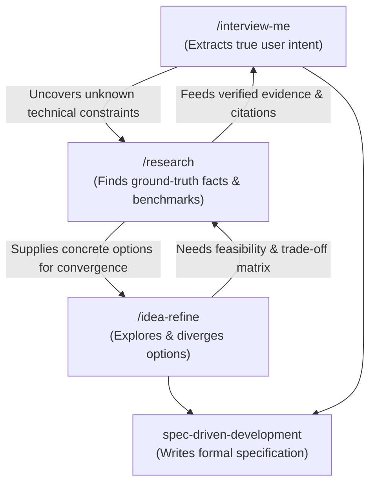

# Technical & Feasibility Research

Conducts rigorous, evidence-based research to validate technical assumptions, survey state-of-the-art solutions, and provide concrete trade-off matrices.

---

## 1. Role in the Workflow Ecosystem

This skill bridges the gap between **ideation/intent extraction** and **engineering implementation**:



- **With `/interview-me`:** When guessing user intent stalls because a technical constraint is unknown (e.g., "Can Gemini Vision output pixel coordinates accurately?", "Does browser extension Manifest V3 allow background WebSockets?"), `research` gathers the exact answers so hypotheses reach $\ge 95\%$ confidence without guessing.
- **With `/idea-refine`:** In Phase 1 (Divergent), `research` discovers real-world prior art and cutting-edge libraries. In Phase 2 (Convergent), `research` builds an objective evaluation matrix (Pros, Cons, Performance, License, Maintenance) to filter options.

---

## 2. When to Use

Apply this skill when:
- Evaluating 2 or more external libraries, frameworks, or AI models.
- Validating whether a technical feature is possible under current ecosystem constraints (e.g., Chrome MV3 restrictions, Python async performance, model token limits).
- Investigating state-of-the-art implementations or prior art for an unsolved problem.
- An agent or human is about to make an architectural choice based on assumptions or stale knowledge.
- Explicitly requested: *"Nghiên cứu về X"*, *"Research alternative solutions for Y"*, *"Compare A vs B"*.

**When NOT to use:**
- Simple factual lookup already defined in the local codebase (inspect local files directly).
- The user has already made an explicit architectural decision documented in an ADR.
- Pure mechanical coding or refactoring.

---

## 3. The 4-Step Research Process

### Step 1: Formulate Targeted Research Questions
Do not start with vague searches. Formulate 2 to 4 crisp, falsifiable technical questions:
- *What specific capability or metric are we validating?* (e.g., latency, memory footprint, accuracy, licensing).
- *What is the hard boundary or deal-breaker?* (e.g., must run offline, must not exceed 100MB model size, must support Japanese vertical text).

### Step 2: Triangulate Evidence (Multi-Source)
Combine three information channels:
1. **Local Codebase & Constraints Check:**
   - Read `CONSTRAINTS.md`, `docs/PROJECT_STATE.md`, and existing ADRs.
   - Any proposed solution **must not violate** established project constraints.
2. **Official Documentation & Source Grounding:**
   - Use `search_web` to locate official documentation, GitHub repositories, and release notes (prefer sources from the last 12-18 months).
   - Use `read_url_content` to read actual API docs, parameter signatures, and deprecation notices.
3. **Real-World Evidence & Pitfalls:**
   - Look for open GitHub issues, real-world benchmarks, and developer post-mortems.
   - Specifically check for known gotchas (memory leaks, rate limits, edge-case failures).

### Step 3: Synthesize into an Objective Decision Matrix
Format findings into a clear comparison table evaluating options against the project's criteria:

```markdown
| Criteria | Option A: [Name] | Option B: [Name] | Option C: [Name] |
|---|---|---|---|
| **Core Architecture** | [...] | [...] | [...] |
| **Performance / Latency** | [...] | [...] | [...] |
| **Resource Footprint** | [...] | [...] | [...] |
| **License & Cost** | [...] | [...] | [...] |
| **Maintenance & Community**| [...] | [...] | [...] |
| **Project Fit & Trade-offs** | [...] | [...] | [...] |
```

### Step 4: Deliver Findings & Recommend Next Steps
1. **Executive Summary:** 2-3 sentences summarizing the definitive answer with citations.
2. **Agent Recommendation:** Concrete recommendation grounded in the project's explicit constraints.
3. **Persistence (Optional):** If the findings represent long-term architectural value, save a brief summary into `docs/research/[topic].md` using [research-template.md](./references/research-template.md).
4. **Feed Back:** Hand control back to `/interview-me`, `/idea-refine`, or the human developer.

---

## 4. Guiding Principles & Quality Standards

- **Zero Hallucination Policy:** Never invent API methods, model parameters, or benchmark numbers. If a library's behavior is unverified, state: *"Unconfirmed in documentation — requires local spike test"*.
- **Always Cite Sources:** Include direct URLs and documentation sections for every major claim.
- **Focus on Edge Cases:** The value of research is discovering what breaks (rate limits, memory pressure, cold starts, CORS issues).
- **Human Authority:** The research proposes and informs; the human developer decides. Present clear options rather than making unilateral architectural choices.
