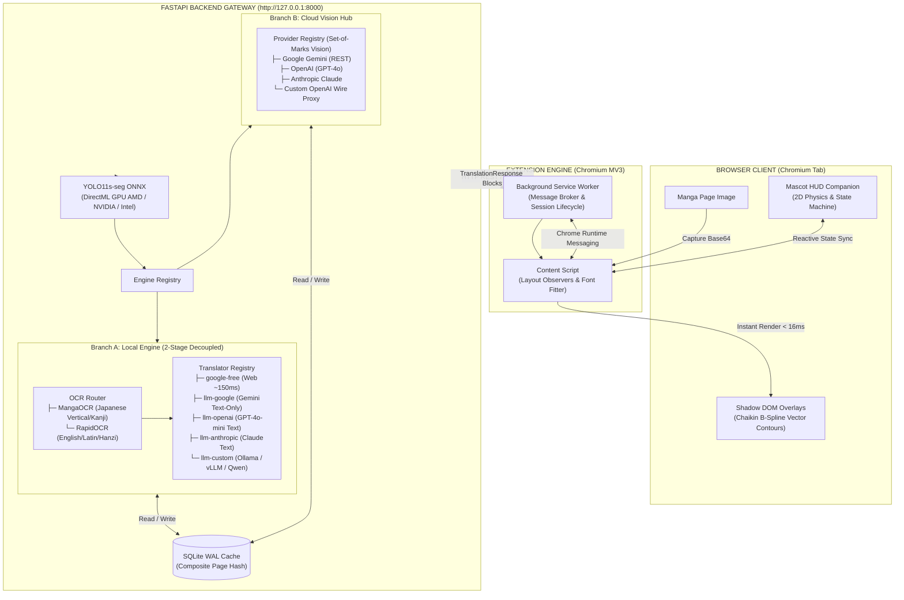

<div align="center">

# InkShift — Real-Time Manga Vision Translation Overlay

> **Real-time in-page manga translation overlays rendered directly in your browser tab.**

<p>
  <a href="https://www.python.org/"></a>
  <a href="https://nodejs.org/"></a>
  <a href="https://developer.chrome.com/docs/extensions/mv3/intro/"></a>
  
  <a href="LICENSE"></a>
</p>

<p>
  <b>English</b> &bull;
  <a href="README.vi.md">Tiếng Việt</a>
</p>

<p>
  <a href="#core-features">Core Features</a> &bull;
  <a href="#system-architecture">System Architecture</a> &bull;
  <a href="#installation-guide">Installation Guide</a> &bull;
  <a href="#usage-guide">Usage Guide</a> &bull;
  <a href="#configuration">Configuration</a> &bull;
  <a href="#technical-comparison">Technical Comparison</a> &bull;
  <a href="#hardware-requirements--compatibility">Hardware Requirements</a> &bull;
  <a href="#troubleshooting">Troubleshooting</a>
</p>

</div>

---

## Core Features

### 1. Non-Destructive Shadow DOM Overlays
- **100% Artwork Preservation**: Translations are rendered inside isolated Shadow DOM v1 layers anchored to page images. Original manga line art, shading, and background details remain completely untouched.
- **Chaikin B-Spline Smoothing**: 2-pass corner cutting transforms discrete staircase YOLO mask prototype edges into smooth, continuous vector contours.
- **Manga Typography Fitter v2**: Binary-search font scaling automatically balances font size (7.5px to 80px) and line breaks to fit speech bubbles without edge clipping.

### 2. Shared Gateway Detection (YOLO11s-seg)
- **DirectML GPU Acceleration**: Runs YOLO11s-seg ONNX inference in ~90-130ms per page on AMD, NVIDIA, or Intel GPUs via DirectX 12 (~300ms CPU fallback).
- **Option G1 Gateway Pattern**: Detection executes once at the gateway level. Pre-detected bubble coordinates and polygons are shared with all downstream engines to eliminate redundant inference.

### 3. Dual-Engine Architecture (Local Hybrid & Cloud Vision)
- **Local Engine (2-Stage Decoupled Pipeline — ADR-006, ADR-008, ADR-012)**:
  - *Stage 1 (On-Device Perception)*: `OCRRouter` routes Japanese vertical text to **MangaOCR** (~0.8-1.2s) and Latin/English/Chinese text to **RapidOCR** (~80-120ms).
  - *Stage 2 (Translator Registry)*: Coordinates 5 swappable translation adapters:
    1. `google-free`: Zero-cost web endpoint (~150ms, no API key required).
    2. `llm-google`: Text-only Gemini translation (>90% token savings vs Vision).
    3. `llm-openai`: Text-only OpenAI GPT-4o-mini translation.
    4. `llm-anthropic`: Text-only Claude 3.5 Sonnet translation.
    5. `llm-custom`: OpenAI-wire compatible local or remote server (Ollama, vLLM, DeepSeek, Qwen).
- **Cloud Vision Hub (ADR-004, ADR-012)**:
  - 4 provider tiers: Google Gemini (REST), OpenAI (GPT-4o), Anthropic Claude, and custom OpenAI-compatible proxies.
  - Set-of-Marks visual grounding for character dialogue localization directly from raw images.

### 4. Smart Reader Layout Adaptation
- **Multi-Mode Layout Detection**: Detects single-page carousels, double-page horizontal spreads, and vertical long strips dynamically.
- **Dynamic Rescaling**: Speech bubbles automatically rescale without mask distortion when manga reader pages adjust viewport dimensions or zoom levels.
- **Domain Whitelisting & Filtering**: Flexible per-domain rule management directly in the extension popup.

### 5. Interactive Mascot HUD & Keyboard Controls
- **Tactile Companion**: Draggable 2D mascot with squash-and-stretch physics that docks anywhere on the screen and persists its position.
- **Live Pipeline State Machine**: Mascot visually reflects pipeline activity (`idle`, `scanning`, `translating`, `success`, `error`, `sleeping`).
- **Instant Controls**: Toggle translations on/off instantly with <kbd>Alt</kbd> + <kbd>Z</kbd> or toggle the Mascot HUD with <kbd>Alt</kbd> + <kbd>M</kbd>.

### 6. Sub-Millisecond SQLite Composite Caching
- **WAL-Mode Caching**: Caches translation responses by composite key `(page_hash, engine, target_lang)`.
- **Zero-Latency Repeat Views**: Re-reading previously translated chapters executes in `< 5ms` directly from local SQLite storage without invoking OCR or AI APIs.

---

## System Architecture



---

## Installation Guide

### Step 1: Environment Prerequisites

| Dependency | Required Version | Purpose |
| :--- | :--- | :--- |
| **Python** | 3.10, 3.11, or 3.12 | Backend server runtime and ONNX execution |
| **Chromium Browser** | Recent release | Google Chrome, Microsoft Edge, Brave, Opera, or Arc |
| **Node.js** | 18+ (LTS recommended) | Extension build toolchain |
| **Git** | Any recent release | Source control checkout |
| **GPU (Optional)** | DirectX 12 compatible | Hardware-accelerated YOLO11 and OCR inference via DirectML |

### Option A: Quick Start (Windows One-Click)

On Windows, you can automate environment provisioning, dependency installation, extension compilation, and gateway startup with a single click:

```bat
start.bat
```
This launcher automatically validates Python (>= 3.10), initializes `.venv`, installs `requirements.txt`, builds the extension bundle to `dist/`, pre-downloads YOLO11 weights, and launches the server at `http://127.0.0.1:8000`.

---

### Option B: Manual Setup (Cross-Platform)

#### Step 1: Backend Gateway Setup

1. **Clone the repository:**
   ```bash
   git clone https://github.com/thailong2103/ink-shift.git
   cd ink-shift
   ```

2. **Create and activate a virtual environment:**
   ```powershell
   # Windows PowerShell
   python -m venv .venv
   .\.venv\Scripts\Activate.ps1
   ```
   ```bash
   # macOS / Linux
   python3 -m venv .venv
   source .venv/bin/activate
   ```

3. **Install dependencies:**
   ```bash
   pip install -r requirements.txt
   ```

4. **Initialize environment configuration:**
   ```powershell
   copy .env.example .env    # Windows
   # cp .env.example .env    # macOS / Linux
   ```

5. **Download YOLO11s-seg ONNX model weights (~25 MB):**
   ```bash
   python scripts/download_models.py
   ```
   *(Optional)* If omitted, the gateway automatically stream-downloads missing weights on first detection request (`INKSHIFT_AUTO_DOWNLOAD_MODELS=true`).

#### Step 2: Browser Extension Build & Load

1. **Install Node dependencies and compile the production bundle:**
   ```bash
   npm install
   npm run build:extension
   ```
   This generates the unpacked extension in the `dist/` directory.

2. **Load into your Chromium browser:**
   - Open `chrome://extensions/` (or `edge://extensions/`).
   - Enable **Developer mode** in the top-right corner.
   - Click **Load unpacked** and select the `dist/` directory from the repository root.

---

## Usage Guide

### 1. Launch the Backend Gateway
```bash
uvicorn src.backend.app:app --host 127.0.0.1 --port 8000
```
The server binds to `127.0.0.1:8000`. The extension communicates locally with this gateway — no public network exposure is required.

### 2. Reading & Translating Manga
1. Navigate to any chapter on [MangaDex](https://mangadex.org) or your preferred manga reader site.
2. The Mascot HUD companion automatically appears in the corner of your reading window.
3. Press <kbd>Alt</kbd> + <kbd>Z</kbd> (or click the Mascot) to translate the active page.
4. Overlays immediately snap to speech bubbles with tailored comic typography.
5. Press <kbd>Alt</kbd> + <kbd>Z</kbd> again to toggle the overlays off and inspect the original art.

### 3. Keyboard Shortcuts

| Shortcut | Scope | Function |
| :---: | :--- | :--- |
| <kbd>Alt</kbd> + <kbd>Z</kbd> | Active Reader Tab | Toggle translation overlays on / off in real-time |
| <kbd>Alt</kbd> + <kbd>M</kbd> | Active Reader Tab | Toggle Mascot HUD companion visibility |
| <kbd>Click Mascot</kbd> | Mascot Companion | Open in-place Bento drawer (Engine, Model, Font, Opacity) |
| <kbd>Drag Mascot</kbd> | Screen Viewport | Reposition mascot freely in 2D space (persisted in local storage) |

> [!NOTE]
> Keyboard shortcuts are intentionally bypassed while typing inside `<input>`, `<textarea>`, `contenteditable`, or during IME text composition.

### 4. Engine & Translator Selection

| Engine Mode | Perception Pipeline | Text Translator Options | Network Requirement |
| :--- | :--- | :--- | :--- |
| **`local` (Hybrid)** | YOLO11s-seg + OCRRouter (MangaOCR / RapidOCR) | `google-free`, `llm-google`, `llm-openai`, `llm-anthropic`, `llm-custom` | Varies by translator (see below) |
| **`cloud` (Vision)** | Multimodal Vision API (Set-of-Marks) | Gemini 2.0, GPT-4o, Claude 3.5, or Custom Vision | Internet required |
| **`mock` (Test)** | Synthetic Bounding Boxes | Deterministic mock strings | Fully offline |

> [!IMPORTANT]
> The default local translator (`google-free`) calls Google Translate's free web endpoint and requires internet access. To achieve a 100% air-gapped, fully self-hosted setup, set `INKSHIFT_LOCAL_DEFAULT_TRANSLATOR=llm-custom` and point `CUSTOM_BASE_URL` to a local Ollama or vLLM instance (e.g. `http://localhost:11434/v1`).

---

## Configuration

InkShift provides **two ways** to configure API keys and runtime endpoints: directly inside the browser extension GUI or via the backend `.env` file.

### Method 1: Extension GUI Settings (Recommended)

You can configure and switch provider credentials on-the-fly without restarting the server:

1. Click the extension icon in your browser toolbar or click the floating Mascot HUD companion on any reader page.
2. Click the **Settings (gear icon)** button to open the Settings Drawer.
3. Open the **API Keys & Providers** accordion:
   - **Google Gemini**: Paste your API key (obtained from [Google AI Studio](https://aistudio.google.com/app/apikey)).
   - **OpenAI**: Paste your API key from [platform.openai.com](https://platform.openai.com/api-keys).
   - **Anthropic Claude**: Paste your API key from [console.anthropic.com](https://console.anthropic.com/).
   - **Custom Endpoint**: Enter your local or custom proxy URL (e.g., `http://localhost:11434/v1` for Ollama).
4. Keys are automatically masked (e.g., `AIzaSy...4xK8`) for screen privacy and synchronized dynamically with the backend.

### Method 2: Backend `.env` File (Developer Setup)

Copy `.env.example` to `.env` in the repository root and configure your target setup:

#### Example A: Google Gemini (Recommended for Cloud Vision & Fast Text LLM)
```bash
# Get your free key at: https://aistudio.google.com/app/apikey
GEMINI_API_KEY=AIzaSyYourGeminiApiKeyHere
GEMINI_MODEL=gemini-2.0-flash
INKSHIFT_CLOUD_PROVIDER=google
```

#### Example B: Local Self-Hosted Ollama (100% Free & Offline)
First start your local model in terminal: `ollama run qwen2.5:7b`
```bash
CUSTOM_BASE_URL=http://localhost:11434/v1
CUSTOM_MODEL=qwen2.5:7b
CUSTOM_API_KEY=ollama

# Use local OCR + local LLM text translation:
INKSHIFT_DEFAULT_ENGINE=local
INKSHIFT_LOCAL_DEFAULT_TRANSLATOR=llm-custom
```

#### Full Variable Reference

<details>
<summary><b>1. Server & Network Settings</b></summary>
<br/>

| Variable | Default | Description |
| :--- | :--- | :--- |
| `INKSHIFT_HOST` | `127.0.0.1` | Local server bind address |
| `INKSHIFT_PORT` | `8000` | Local server bind port |
| `INKSHIFT_DEFAULT_ENGINE` | `mock` | Default active engine: `cloud`, `local`, or `mock` |
| `INKSHIFT_DB_PATH` | `./data/cache.db` | SQLite cache and context graph database path |
| `INKSHIFT_MAX_PAYLOAD_SIZE` | `20000000` | Maximum request payload size in bytes (~20 MB) |

</details>

<details>
<summary><b>2. Cloud Vision Hub Settings</b></summary>
<br/>

| Variable | Default | Description |
| :--- | :--- | :--- |
| `GEMINI_API_KEY` | *(empty)* | Google Gemini API key |
| `OPENAI_API_KEY` | *(empty)* | OpenAI API key |
| `ANTHROPIC_API_KEY` | *(empty)* | Anthropic Claude API key |
| `CUSTOM_BASE_URL` | `https://api.openai.com/v1` | Custom OpenAI-wire compatible endpoint |
| `CUSTOM_MODEL` | *(empty)* | Custom model name (e.g. `qwen2.5:7b`, `deepseek-chat`) |
| `INKSHIFT_CLOUD_PROVIDER` | `google` | Active cloud provider: `google`, `openai`, `anthropic`, `custom` |
| `INKSHIFT_CLOUD_TIMEOUT` | `30.0` | Upstream HTTP timeout in seconds |

</details>

<details>
<summary><b>3. Local Engine & OCR Settings</b></summary>
<br/>

| Variable | Default | Description |
| :--- | :--- | :--- |
| `INKSHIFT_LOCAL_MODEL_DIR` | `./.cache/inkshift/models` | Directory path for stored ONNX model weights |
| `INKSHIFT_LOCAL_DEFAULT_OCR` | `auto` | OCR routing strategy: `auto`, `manga-ocr`, `rapidocr` |
| `INKSHIFT_LOCAL_DEFAULT_TRANSLATOR` | `google-free` | Text translator: `google-free`, `llm-google`, `llm-openai`, `llm-anthropic`, `llm-custom` |
| `INKSHIFT_LOCAL_EXECUTION_PROVIDER` | `directml` | ONNX execution provider: `directml`, `cuda`, `cpu` |

</details>

<details>
<summary><b>4. Logging & Diagnostics</b></summary>
<br/>

| Variable | Default | Description |
| :--- | :--- | :--- |
| `INKSHIFT_LOG_LEVEL` | `WARNING` | Log severity threshold: `DEBUG`, `INFO`, `WARNING`, `ERROR` |
| `INKSHIFT_LOG_DIR` | `./data/logs` | Destination directory for rotating log files |

</details>

---

## Technical Comparison

### Overlay Techniques Comparison

| Technical Dimension | Destructive Inpainting | Floating Popups | InkShift In-Page Overlay |
| :--- | :--- | :--- | :--- |
| **Source artwork integrity** | Overwritten / Blurred pixels | Preserved | **100% original pixels intact (Shadow DOM)** |
| **Reading immersion** | Requires full page reload | Covers adjacent panels | **Inline speech bubbles with zero layout shift** |
| **Instant toggle** | Irreversible without page reload | Close popover window | **Real-time via <kbd>Alt</kbd> + <kbd>Z</kbd>** |
| **Contour precision** | Rectangular bounding masks | Fixed rectangular cards | **Vector B-spline contours (Chaikin subdivision)** |
| **Typography scaling** | Fixed font sizes (clipping) | N/A | **Dynamic binary-search font fitting v2** |

### Empirical Latency Breakdown (Per Manga Page ~5-8 Bubbles)

| Pipeline Component | Underlying Technology | Typical Latency (GPU) | CPU Fallback | Notes |
| :--- | :--- | :--- | :--- | :--- |
| **Bubble Detection** | YOLO11s-seg ONNX | **90 – 130 ms** | ~300 ms | DirectML FP16 acceleration |
| **OCR (English / Latin)** | RapidOCR ONNX | **80 – 120 ms** | ~180 ms | Single-pass full-page recognition |
| **OCR (Japanese Kanji/Vertical)** | MangaOCR ONNX | **800 – 1,200 ms** | ~2,500 ms | Tate-gaki vertical sequence recognition |
| **Translation: Google Free** | Web Batch Dispatch | **150 – 200 ms** | ~150 ms | Zero cost, batch joined payload |
| **Translation: Gemini Text-Only** | REST API (Text Prompt) | **300 – 450 ms** | ~350 ms | >90% token savings vs Vision LLM |
| **Cloud Vision (End-to-End)** | Gemini 2.0 / GPT-4o Vision | **1,200 – 1,800 ms** | ~1,500 ms | Sends full page image; bypasses local OCR |
| **Repeat Cache View** | SQLite WAL Composite Index | **< 5 ms** | **< 5 ms** | Bypasses detection, OCR, and translation |
| **DOM Injection** | Chromium Shadow DOM v1 | **< 16 ms** | **< 16 ms** | Single frame render budget (60 fps) |

---

## Hardware Requirements & Compatibility

- **Operating System**: Windows 10 or Windows 11 (DirectX 12 recommended for DirectML acceleration). Linux and macOS supported via CPU or CUDA execution.
- **GPU Acceleration**:
  - AMD Radeon (RX 5000 / 6000 / 7000 series, or Radeon 680M / 780M iGPU).
  - NVIDIA GeForce (GTX 10-series, RTX 20 / 30 / 40 series).
  - Intel Arc or Intel Iris Xe Graphics.
- **CPU Fallback**: Automatic fallback to CPU inference if no compatible GPU is detected.
- **Memory**: Minimum 4 GB RAM available.
- **Browser Compatibility**: Chromium-based browsers (Google Chrome, Microsoft Edge, Brave, Opera, Arc).

---

## Troubleshooting

<details>
<summary><b>1. DirectML execution fails on Linux or macOS</b></summary>
<br/>

DirectML hardware acceleration is specific to Windows DirectX 12. On Linux or macOS, configure your `.env` to use CPU or CUDA:
```bash
INKSHIFT_LOCAL_EXECUTION_PROVIDER=cpu    # or "cuda" if NVIDIA GPU is configured
```
</details>

<details>
<summary><b>2. Extension cannot connect to the backend server</b></summary>
<br/>

- Verify that the FastAPI server is running at `http://127.0.0.1:8000` via terminal output.
- If you modified `INKSHIFT_PORT`, update the matching entry in `src/extension/manifest.json` under `host_permissions`.
- Test the health endpoint directly in your browser: `http://127.0.0.1:8000/api/v1/cache/stats`.
</details>

<details>
<summary><b>3. Model weights download was interrupted</b></summary>
<br/>

If `python scripts/download_models.py` fails due to network instability, verify the destination directory `.cache/inkshift/models/`. You can re-run the download script with forced overwrite:
```bash
python scripts/download_models.py --force
```
With `INKSHIFT_AUTO_DOWNLOAD_MODELS=true` set in `.env`, the gateway will also automatically attempt to recover missing weights during server startup.
</details>

<details>
<summary><b>4. Shortcuts (Alt+Z or Alt+M) do not trigger translation</b></summary>
<br/>

Shortcuts are deliberately suppressed when user focus is inside an `<input>`, `<textarea>`, or `contenteditable` container, or while typing with an IME (Vietnamese Telex/VNI or Japanese input). Click any empty area on the page to reset focus before pressing <kbd>Alt</kbd> + <kbd>Z</kbd>.
</details>

---

## Project Quality & Engineering Boundaries

The project enforces a strict quality bar codified in [CONSTRAINTS.md](CONSTRAINTS.md):

- **Zero Suppression Policy**: Zero `@ts-ignore`, `# type: ignore`, `# noqa`, or `eslint-disable` comments permitted.
- **Strict Static Typing**: Both `tsc --noEmit` (TypeScript) and `mypy --strict` (Python) must pass with 0 errors.
- **Comprehensive Test Suite**: 250+ extension tests (Vitest) and 295+ backend tests (pytest) with $\ge 80\%$ line coverage.
- **Floor Guard Security**: Automated scans verify zero hardcoded secrets or API tokens in git history.

Execute the multi-stage quality gate locally:
```bash
python scripts/check.py --fast    # Floor Guard + types + lint (< 5s budget)
python scripts/check.py --task    # Fast check + full test suites + diff coverage (< 90s budget)
python scripts/check.py --full    # Full check + security and vulnerability heuristics
```

---

## Contributing & License

InkShift is released under the **MIT License**. For complete terms, see the [LICENSE](LICENSE) file.

Contributions, bug reports, and architectural proposals are welcome. Please open an issue to discuss your intended changes before submitting a pull request.

---

<div align="center">
  <sub>InkShift • Non-destructive in-page manga vision translation. Distributed under the MIT License.</sub>
</div>
