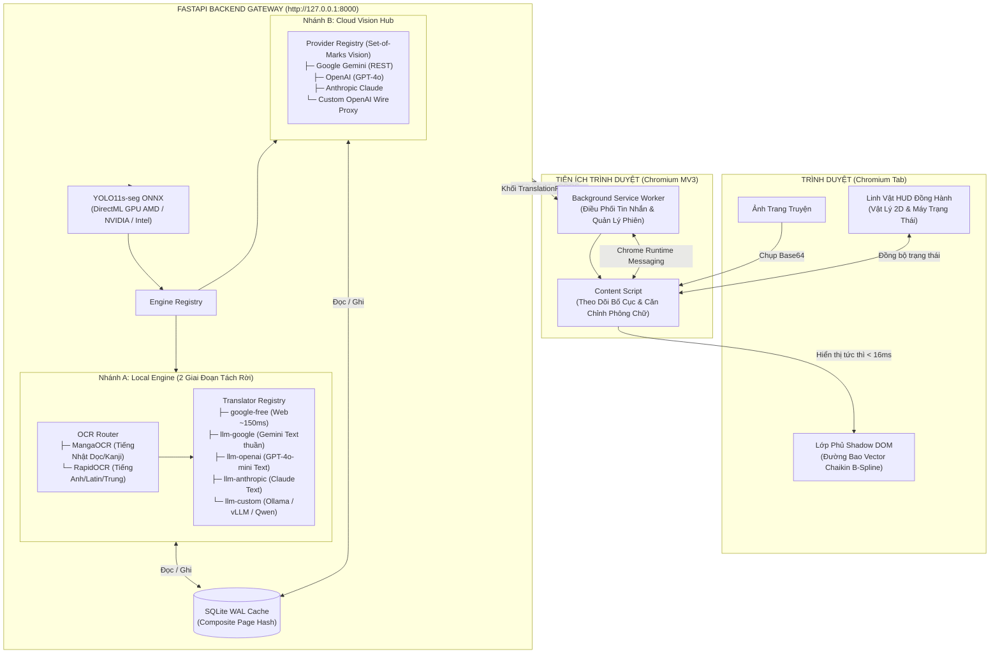

<div align="center">

# InkShift — Hệ Thống Dịch Truyện Tranh Thời Gian Thực

> **Lớp phủ dịch truyện tranh thời gian thực đè trực tiếp lên khung thoại trong trình duyệt.**  

<p>
  <a href="https://www.python.org/"></a>
  <a href="https://nodejs.org/"></a>
  <a href="https://developer.chrome.com/docs/extensions/mv3/intro/"></a>
  
  <a href="LICENSE"></a>
</p>

<p>
  <a href="README.md">English</a> &bull;
  <b>Tiếng Việt</b>
</p>

<p>
  <a href="#tính-năng-cốt-lõi">Tính Năng Cốt Lõi</a> &bull;
  <a href="#kiến-trúc-hệ-thống">Kiến Trúc Hệ Thống</a> &bull;
  <a href="#hướng-dẫn-cài-đặt">Hướng Dẫn Cài Đặt</a> &bull;
  <a href="#hướng-dẫn-sử-dụng">Hướng Dẫn Sử Dụng</a> &bull;
  <a href="#cấu-hình">Cấu Hình</a> &bull;
  <a href="#so-sánh-kỹ-thuật">So Sánh Kỹ Thuật</a> &bull;
  <a href="#yêu-cầu-phần-cứng--tương-thích">Yêu Cầu Phần Cứng</a> &bull;
  <a href="#khắc-phục-sự-cố">Khắc Phục Sự Cố</a>
</p>

</div>

---

## Tính Năng Cốt Lõi

### 1. Lớp Phủ Shadow DOM Không Phá Hủy Nét Vẽ
- **Bảo toàn 100% tác phẩm**: Bản dịch được hiển thị bên trong các lớp Shadow DOM v1 cô lập neo vào ảnh truyện. Nét vẽ gốc, độ tương phản và hình nền của tác giả được giữ nguyên vẹn tuyệt đối.
- **Làm mịn đường bao Chaikin B-Spline**: Thuật toán cắt góc 2 lượt biến các đường bậc thang của mặt nạ YOLO thô thành đường cong vector mượt mà ôm sát bóng thoại.
- **Tự động căn chỉnh phông chữ (Typography Fitter v2)**: Thuật toán tìm kiếm nhị phân tự động cân bằng cỡ chữ (từ 7.5px đến 80px) và ngắt dòng hợp lý để bản dịch vừa khít bóng thoại mà không bị tràn viền.

### 2. Phát Hiện Tập Trung Tại Cổng Kết Nối (YOLO11s-seg)
- **Tăng tốc phần cứng GPU qua DirectML**: Chạy mô hình phân đoạn ONNX YOLO11s-seg chỉ mất ~90-130ms mỗi trang trên GPU AMD, NVIDIA hoặc Intel qua DirectX 12 (có chế độ CPU fallback ~300ms).
- **Mô hình cổng Option G1 Gateway**: Quá trình nhận diện bóng thoại chỉ chạy duy nhất một lần tại tầng Gateway. Tọa độ và đa giác bóng thoại được chia sẻ trực tiếp cho các engine dịch phía sau, loại bỏ hoàn toàn việc tính toán trùng lặp.

### 3. Kiến Trúc Hai Engine Độc Lập (Local Hybrid & Cloud Vision)
- **Local Engine (Quy trình 2 giai đoạn tách rời — ADR-006, ADR-008, ADR-012)**:
  - *Giai đoạn 1 (Nhận diện ký tự On-Device)*: `OCRRouter` tự động điều hướng tiếng Nhật dọc sang **MangaOCR** (~0.8-1.2s) và tiếng Anh/Latin/Trung sang **RapidOCR** (~80-120ms).
  - *Giai đoạn 2 (Kho bộ chuyển ngữ Translator Registry)*: Quản lý 5 bộ chuyển ngữ linh hoạt:
    1. `google-free`: Endpoint web miễn phí $0 (~150ms, không cần API key).
    2. `llm-google`: Dịch văn bản thuần qua Gemini (tiết kiệm hơn 90% token so với Vision).
    3. `llm-openai`: Dịch văn bản qua OpenAI GPT-4o-mini.
    4. `llm-anthropic`: Dịch văn bản qua Claude 3.5 Sonnet.
    5. `llm-custom`: Tương thích chuẩn OpenAI với các máy chủ cục bộ hoặc proxy tự dựng (Ollama, vLLM, DeepSeek, Qwen).
- **Cloud Vision Hub (ADR-004, ADR-012)**:
  - Hỗ trợ 4 nhà cung cấp: Google Gemini (REST), OpenAI (GPT-4o), Anthropic Claude và proxy tùy chỉnh tương thích OpenAI.
  - Sử dụng cơ chế trực quan Set-of-Marks để xác định lời thoại nhân vật trực tiếp từ ảnh gốc.

### 4. Tự Động Thích Ứng Bố Cục Trang Đọc
- **Hỗ trợ đa dạng bố cục**: Tự động nhận diện chế độ xem từng trang đơn, trang đôi nằm ngang hoặc cuộn dọc dài (webtoon).
- **Co giãn tỉ lệ động**: Lớp phủ tự động điều chỉnh tọa độ và kích thước khi trang truyện thay đổi độ thu phóng hoặc kích thước cửa sổ trình duyệt.
- **Bộ lọc tên miền linh hoạt**: Quản lý danh sách trang web được phép hoặc chặn dịch ngay trong giao diện tiện ích.

### 5. Linh Vật Đồng Hành HUD & Phím Tắt Nhanh
- **Linh vật điều khiển trực quan**: Có thể kéo thả tự do trên màn hình, lưu vị trí cục bộ và có hiệu ứng nảy vật lý.
- **Phản hồi trạng thái thời gian thực**: Linh vật biểu thị trạng thái hệ thống (`chờ`, `đang quét`, `đang dịch`, `thành công`, `lỗi`, `ngủ`).
- **Phím tắt tiện dụng**: Bật/tắt nhanh bản dịch tức thì bằng phím <kbd>Alt</kbd> + <kbd>Z</kbd> hoặc ẩn/hiện linh vật bằng <kbd>Alt</kbd> + <kbd>M</kbd>.

### 6. Bộ Nhớ Đệm SQLite Tổng Hợp Tốc Độ Cao
- **Lưu đệm chế độ WAL**: Lưu trữ kết quả dịch theo khóa tổng hợp `(page_hash, engine, target_lang)`.
- **Xem lại không độ trễ**: Đọc lại các chương truyện đã từng dịch chỉ mất `< 5ms` trực tiếp từ SQLite cục bộ, không cần gọi lại OCR hay tốn thêm chi phí API.

---

## Kiến Trúc Hệ Thống



---

## Hướng Dẫn Cài Đặt

### Bước 1: Yêu Cầu Môi Trường

| Phần mềm | Phiên bản yêu cầu | Mục đích sử dụng |
| :--- | :--- | :--- |
| **Python** | 3.10, 3.11, hoặc 3.12 | Môi trường máy chủ Backend và thực thi mô hình ONNX |
| **Trình duyệt Chromium** | Bản phát hành gần đây | Google Chrome, Microsoft Edge, Brave, Opera, Arc, Cốc Cốc |
| **Node.js** | 18+ (Khuyên dùng bản LTS) | Biên dịch tiện ích mở rộng Extension |
| **Git** | Bản phát hành bất kỳ | Quản lý mã nguồn |
| **GPU (Tùy chọn)** | Hỗ trợ DirectX 12 | Tăng tốc nhận diện YOLO11 và OCR bằng DirectML |

---

### Cách 1: Khởi Động Nhanh Bằng 1 Cú Click (Dành cho Windows)

Trên Windows, bạn có thể tự động hóa toàn bộ việc tạo môi trường, cài đặt thư viện, biên dịch extension và khởi động server chỉ với một thao tác:

```bat
start.bat
```
Tệp thực thi này sẽ tự động kiểm tra Python (>= 3.10), khởi tạo môi trường ảo `.venv`, cài đặt `requirements.txt`, biên dịch tiện ích vào thư mục `dist/`, tải trước trọng số mô hình YOLO11 và khởi chạy server tại `http://127.0.0.1:8000`.

---

### Cách 2: Cài Đặt Thủ Công (Đa Nền Tảng: Windows / Linux / macOS)

#### Bước 1: Cài Đặt Backend Gateway

1. **Sao chép mã nguồn về máy:**
   ```bash
   git clone https://github.com/thailong2103/ink-shift.git
   cd ink-shift
   ```

2. **Khởi tạo và kích hoạt môi trường ảo:**
   ```powershell
   # Windows PowerShell
   python -m venv .venv
   .\.venv\Scripts\Activate.ps1
   ```
   ```bash
   # macOS / Linux
   python3 -m venv .venv
   source .venv/bin/activate
   ```

3. **Cài đặt các gói thư viện Python:**
   ```bash
   pip install -r requirements.txt
   ```

4. **Khởi tạo tệp cấu hình môi trường:**
   ```powershell
   copy .env.example .env    # Windows
   # cp .env.example .env    # macOS / Linux
   ```

5. **Tải trọng số mô hình ONNX YOLO11s-seg (~25 MB):**
   ```bash
   python scripts/download_models.py
   ```
   *(Tùy chọn)* Nếu bạn bỏ qua bước này, hệ thống sẽ tự động stream tải mô hình từ Hugging Face trong lần dịch đầu tiên nếu bật `INKSHIFT_AUTO_DOWNLOAD_MODELS=true`.

#### Bước 2: Biên Dịch Tiện Ích Mở Rộng Extension

1. **Cài đặt thư viện Node và biên dịch mã nguồn:**
   ```bash
   npm install
   npm run build:extension
   ```
   Lệnh này sẽ tạo ra bộ tiện ích hoàn chỉnh bên trong thư mục `dist/`.

2. **Nạp tiện ích vào trình duyệt Chromium:**
   - Mở địa chỉ `chrome://extensions/` (hoặc `edge://extensions/`).
   - Bật **Chế độ dành cho nhà phát triển (Developer mode)** ở góc trên bên phải.
   - Nhấn nút **Tải tiện ích đã giải nén (Load unpacked)** và trỏ vào thư mục `dist/` tại thư mục gốc của dự án.

---

## Hướng Dẫn Sử Dụng

### 1. Khởi Chạy Backend Gateway
```bash
uvicorn src.backend.app:app --host 127.0.0.1 --port 8000
```
Server sẽ chạy cục bộ tại `127.0.0.1:8000`. Tiện ích mở rộng kết nối với cổng này hoàn toàn nội bộ trong máy, không mở bất kỳ cổng kết nối công khai nào ra Internet.

### 2. Đọc và Dịch Truyện
1. Mở bất kỳ chương truyện nào trên [MangaDex](https://mangadex.org) hoặc trang đọc truyện yêu thích của bạn.
2. Linh vật Mascot HUD sẽ tự động xuất hiện ở góc trang đọc.
3. Nhấn <kbd>Alt</kbd> + <kbd>Z</kbd> (hoặc nhấp chuột vào Linh vật) để dịch trang đang xem.
4. Lớp phủ dịch sẽ ngay lập tức xuất hiện đè lên các bóng thoại với định dạng chữ truyện tranh.
5. Nhấn <kbd>Alt</kbd> + <kbd>Z</kbd> một lần nữa để ẩn lớp phủ và xem lại tranh gốc.

### 3. Bảng Phím Tắt Điều Khiển

| Phím tắt | Phạm vi hoạt động | Chức năng |
| :---: | :--- | :--- |
| <kbd>Alt</kbd> + <kbd>Z</kbd> | Tab truyện đang mở | Bật / tắt hiển thị lớp phủ dịch thời gian thực |
| <kbd>Alt</kbd> + <kbd>M</kbd> | Tab truyện đang mở | Ẩn / hiện linh vật đồng hành Mascot HUD |
| <kbd>Nhấp Linh vật</kbd> | Linh vật HUD | Mở ngăn cài đặt nhanh (Engine, Model, Phông chữ, Độ mờ) |
| <kbd>Kéo Linh vật</kbd> | Toàn màn hình | Di chuyển vị trí linh vật tự do (tự lưu vị trí vào bộ nhớ trình duyệt) |

> [!NOTE]
> Phím tắt được tự động vô hiệu hóa khi con trỏ chuột đang nằm trong ô nhập liệu (`<input>`, `<textarea>`, `contenteditable`) hoặc khi đang gõ tiếng Việt có dấu (bộ gõ IME) để tránh gõ nhầm.

### 4. Lựa Chọn Engine & Trình Dịch

| Chế độ Engine | Quy trình xử lý hình ảnh | Lựa chọn dịch văn bản | Yêu cầu kết nối mạng |
| :--- | :--- | :--- | :--- |
| **`local` (Hybrid)** | YOLO11s-seg + OCRRouter (MangaOCR / RapidOCR) | `google-free`, `llm-google`, `llm-openai`, `llm-anthropic`, `llm-custom` | Tùy bộ dịch đã chọn |
| **`cloud` (Vision)** | Multimodal Vision API (Set-of-Marks) | Gemini 2.0, GPT-4o, Claude 3.5, hoặc Custom Vision | Bắt buộc có kết nối Internet |
| **`mock` (Test)** | Tạo khung thoại mẫu giả lập | Trả về chuỗi thử nghiệm có sẵn | Hoàn toàn offline |

> [!IMPORTANT]
> Trình dịch cục bộ mặc định (`google-free`) sử dụng endpoint web miễn phí của Google Translate và cần có Internet. Để vận hành 100% offline hoàn toàn không cần mạng, bạn hãy thiết lập `INKSHIFT_LOCAL_DEFAULT_TRANSLATOR=llm-custom` và trỏ `CUSTOM_BASE_URL` tới máy chủ Ollama hoặc vLLM cục bộ (ví dụ: `http://localhost:11434/v1`).

---

## Cấu Hình

InkShift hỗ trợ **2 cách cấu hình**: trực tiếp trong giao diện của tiện ích trình duyệt hoặc thông qua tệp `.env` của backend.

### Cách 1: Thiết Lập Trong Giao Diện Tiện Ích (Khuyên dùng)

Bạn có thể thay đổi API key và endpoint trực tiếp mà không cần khởi động lại máy chủ backend:

1. Bấm vào biểu tượng tiện ích trên thanh công cụ trình duyệt hoặc nhấp vào linh vật Mascot HUD trên trang truyện.
2. Bấm nút **Cài đặt (biểu tượng bánh răng)** để mở ngăn cài đặt.
3. Mở mục **API Keys & Providers**:
   - **Google Gemini**: Dán API key (lấy miễn phí tại [Google AI Studio](https://aistudio.google.com/app/apikey)).
   - **OpenAI**: Dán API key từ [platform.openai.com](https://platform.openai.com/api-keys).
   - **Anthropic Claude**: Dán API key từ [console.anthropic.com](https://console.anthropic.com/).
   - **Custom Endpoint**: Nhập URL máy chủ cục bộ hoặc proxy (ví dụ: `http://localhost:11434/v1` cho Ollama).
4. Các khóa API sẽ tự động được ẩn bớt ký tự (ví dụ: `AIzaSy...4xK8`) để bảo mật màn hình và đồng bộ tự động với máy chủ backend.

### Cách 2: Thiết Lập Bằng Tệp `.env` (Dành cho Developer)

Sao chép tệp `.env.example` thành `.env` tại thư mục gốc và tùy chỉnh cấu hình:

#### Ví dụ A: Dùng Google Gemini (Khuyên dùng cho Cloud Vision & Text LLM tốc độ cao)
```bash
# Lấy API key miễn phí tại: https://aistudio.google.com/app/apikey
GEMINI_API_KEY=AIzaSyYourGeminiApiKeyHere
GEMINI_MODEL=gemini-2.0-flash
INKSHIFT_CLOUD_PROVIDER=google
```

#### Ví dụ B: Dùng Ollama Cục Bộ Máy Tự Dựng (100% Miễn phí & Hoàn toàn Offline)
Trước tiên chạy mô hình trong terminal: `ollama run qwen2.5:7b`
```bash
CUSTOM_BASE_URL=http://localhost:11434/v1
CUSTOM_MODEL=qwen2.5:7b
CUSTOM_API_KEY=ollama

# Dùng OCR trên máy + LLM nội bộ dịch văn bản:
INKSHIFT_DEFAULT_ENGINE=local
INKSHIFT_LOCAL_DEFAULT_TRANSLATOR=llm-custom
```

---

## So Sánh Kỹ Thuật

### So Sánh Phương Pháp Hiển Thị Bản Dịch

| Tiêu chí kỹ thuật | Phương pháp Inpainting xóa ảnh | Hộp thoại nổi Pop-up | Lớp phủ In-Page của InkShift |
| :--- | :--- | :--- | :--- |
| **Bảo toàn nét vẽ gốc** | Bị vẽ đè / mờ pixel xung quanh | Giữ nguyên | **100% điểm ảnh gốc nguyên vẹn (Shadow DOM)** |
| **Độ tập trung khi đọc** | Phải tải lại toàn bộ trang ảnh | Che khuất các ô tranh bên cạnh | **Vừa khít bóng thoại, không giật dịch chuyển trang** |
| **Bật/tắt tức thì** | Không thể hoàn tác nếu không reload | Phải đóng cửa sổ pop-up | **Thời gian thực qua phím <kbd>Alt</kbd> + <kbd>Z</kbd>** |
| **Độ khít của đường bao** | Mặt nạ vuông thô kệch | Khung chữ nhật cố định | **Đường cong vector B-spline (thuật toán Chaikin)** |
| **Co giãn cỡ chữ** | Cố định cỡ chữ (dễ bị cắt chữ) | Không áp dụng | **Tự động căn chỉnh bằng tìm kiếm nhị phân v2** |

### Đo Đạc Thời Gian Xử Lý Thực Tế (Mỗi trang truyện ~5-8 bóng thoại)

| Thành phần xử lý | Công nghệ bên dưới | Độ trễ thông thường (GPU) | Chạy bằng CPU | Ghi chú |
| :--- | :--- | :--- | :--- | :--- |
| **Nhận diện bóng thoại** | YOLO11s-seg ONNX | **90 – 130 ms** | ~300 ms | Tăng tốc DirectML FP16 |
| **OCR (Tiếng Anh / Latin)** | RapidOCR ONNX | **80 – 120 ms** | ~180 ms | Quét một lượt toàn trang |
| **OCR (Tiếng Nhật dọc/Kanji)** | MangaOCR ONNX | **800 – 1.200 ms** | ~2.500 ms | Quét dọc theo từng bóng thoại |
| **Dịch: Google Free** | Web Batch Dispatch | **150 – 200 ms** | ~150 ms | Hoàn toàn miễn phí |
| **Dịch: Gemini Text thuần** | REST API (Prompt chữ) | **300 – 450 ms** | ~350 ms | Tiết kiệm >90% token so với Vision |
| **Cloud Vision (Trọn gói)** | Gemini 2.0 / GPT-4o Vision | **1.200 – 1.800 ms** | ~1.500 ms | Gửi cả trang ảnh; bỏ qua OCR máy |
| **Xem lại trang đã lưu đệm** | SQLite WAL Composite Index | **< 5 ms** | **< 5 ms** | Bỏ qua toàn bộ AI và dịch thuật |
| **Gắn vào DOM trình duyệt** | Chromium Shadow DOM v1 | **< 16 ms** | **< 16 ms** | Hiển thị mượt mà trong 1 khung hình (60 fps) |

---

## Yêu Cầu Phần Cứng & Tương Thích

- **Hệ điều hành**: Windows 10 hoặc Windows 11 (khuyên dùng DirectX 12 để tăng tốc DirectML). Linux và macOS hỗ trợ chạy qua CPU hoặc CUDA.
- **Tăng tốc GPU**:
  - AMD Radeon (Dòng RX 5000 / 6000 / 7000, hoặc iGPU Radeon 680M / 780M).
  - NVIDIA GeForce (Dòng GTX 10-series, RTX 20 / 30 / 40 series).
  - Intel Arc hoặc Intel Iris Xe Graphics.
- **Dự phòng CPU**: Tự động chuyển về chạy bằng CPU nếu máy không có GPU tương thích.
- **Bộ nhớ (RAM)**: Tối thiểu 4 GB RAM trống.
- **Trình duyệt**: Các trình duyệt dựa trên nhân Chromium (Google Chrome, Microsoft Edge, Brave, Opera, Arc, Cốc Cốc).

---

## Khắc Phục Sự Cố

<details>
<summary><b>1. Lỗi chạy DirectML trên Linux hoặc macOS</b></summary>
<br/>

Tăng tốc phần cứng DirectML là công nghệ dành riêng cho DirectX 12 trên Windows. Trên Linux hoặc macOS, bạn hãy cấu hình trong tệp `.env` để sử dụng CPU hoặc CUDA:
```bash
INKSHIFT_LOCAL_EXECUTION_PROVIDER=cpu    # hoặc "cuda" nếu máy có card NVIDIA
```
</details>

<details>
<summary><b>2. Tiện ích mở rộng không kết nối được với máy chủ Backend</b></summary>
<br/>

- Kiểm tra xem máy chủ FastAPI đã chạy tại địa chỉ `http://127.0.0.1:8000` trong cửa sổ dòng lệnh chưa.
- Nếu bạn đổi cổng `INKSHIFT_PORT`, hãy cập nhật cổng tương ứng trong `src/extension/manifest.json` tại mục `host_permissions`.
- Kiểm tra trực tiếp endpoint sức khỏe trên trình duyệt: `http://127.0.0.1:8000/api/v1/cache/stats`.
</details>

<details>
<summary><b>3. Bị gián đoạn khi tải trọng số mô hình YOLO11</b></summary>
<br/>

Nếu lệnh `python scripts/download_models.py` bị lỗi do mạng, bạn hãy kiểm tra thư mục `.cache/inkshift/models/`. Có thể chạy lại lệnh với cờ ép buộc tải lại:
```bash
python scripts/download_models.py --force
```
Khi bật `INKSHIFT_AUTO_DOWNLOAD_MODELS=true` trong `.env`, server cũng sẽ tự động tải bù nếu phát hiện thiếu file lúc khởi động.
</details>

<details>
<summary><b>4. Phím tắt (Alt+Z hoặc Alt+M) không kích hoạt được dịch</b></summary>
<br/>

Phím tắt được cố ý bỏ qua khi con trỏ chuột đang nằm trong các ô văn bản `<input>`, `<textarea>` hoặc khi bộ gõ tiếng Việt (Telex/VNI) đang soạn dấu. Bạn chỉ cần nhấp chuột ra ngoài khoảng trống của trang web trước khi bấm tổ hợp phím <kbd>Alt</kbd> + <kbd>Z</kbd>.
</details>

---

## Tiêu Chuẩn Kỹ Thuật Dự Án

Dự án áp dụng chặt chẽ hợp đồng kiểm soát chất lượng quy định tại [CONSTRAINTS.md](CONSTRAINTS.md):

- **Không sử dụng cờ bỏ qua lỗi**: Tuyệt đối không sử dụng `@ts-ignore`, `# type: ignore`, `# noqa` hay `eslint-disable`.
- **Kiểm tra kiểu dữ liệu nghiêm ngặt**: Cả `tsc --noEmit` (TypeScript) và `mypy --strict` (Python) phải vượt qua với 0 lỗi.
- **Bộ kiểm thử toàn diện**: Hơn 250 bài test cho tiện ích (Vitest) và hơn 295 bài test cho backend (pytest) với độ bao phủ dòng $\ge 80\%$.
- **Bảo mật mã nguồn**: Bộ quét tự động đảm bảo không có bất kỳ API key hay bí mật nào bị commit vào lịch sử git.

---

## Đóng Góp & Giấy Phép

InkShift được phát hành dưới điều khoản của **Giấy phép MIT**. Xem chi tiết tại tệp [LICENSE](LICENSE).

Mọi đóng góp, báo cáo lỗi và đề xuất kiến trúc đều được hoan nghênh. Vui lòng mở Issue để thảo luận trước khi gửi Pull Request.

---

<div align="center">
  <sub>InkShift • Lớp phủ dịch truyện tranh thời gian thực không phá hủy nét vẽ. Phát hành theo Giấy phép MIT.</sub>
</div>
