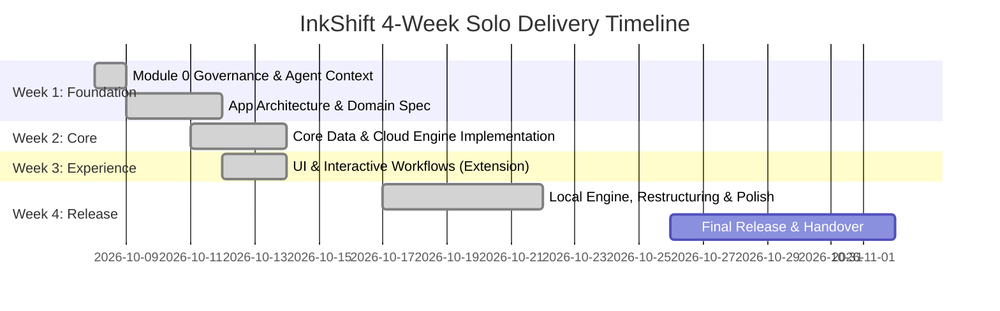
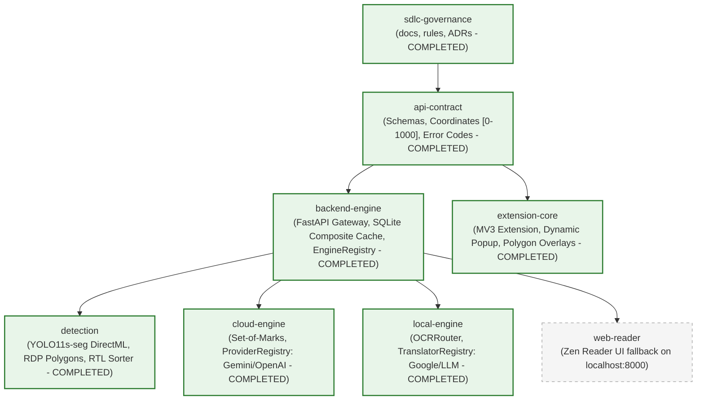

# InkShift: Project State & Living Dashboard

> **Last Updated:** 2026-10-27  
> **Active Milestone:** Phase 33 Completed — Comprehensive Technical Project Report Synthesis & Verification  
> **Solo Developer Timeline:** 4-Week Build  
> **Primary Rule:** *"The agent proposes; the human decides. No exceptions."*  

---

## 1. Executive Summary & Current Status

InkShift is a solo developer project running on a focused 4-week delivery cycle.  
The current phase has completed **Module 0 (Governance)**, **Module 1: `api-contract`**, **Module 2: `backend-engine`**, **Module 3: `cloud-engine`**, **Module 4: `extension-core`**, **Module 5: `local-engine`**, **Phases 15–32**, and **Phase 33: Comprehensive Technical Project Report Synthesis (Drafted and verified publication-grade `BAO_CAO_TONG_HOP.md` adhering to 8-part standard and submission guidelines, embedded concise algorithmic code snippets, standardized 7 technical figures with exact assets, validated Pre-Submission Checklist 100%)**.

| Metric | Current State | Target |
|---|---|---|
| **Timeline Status** | Phase 33 Completed (Technical Synthesis Report Verified) | 4 Weeks Total |
| **Active Module** | `extension-core` (Phase 30: Modular UI & Anti-Slop System) | Authentic Manga UI/UX |
| **Working Tree Status** | Clean commits / Strict zero-suppression bar | Clean commits |
| **Agent Protocol** | Codified in `AGENTS.md` & `.agents/rules/` | Deterministic bootstrap |

---

## 2. Four-Week Milestone Roadmap

- **Week 1 (Oct 08 – Oct 14):** Foundation, Governance, Agent Context Protocols, Application Architecture Spec.
- **Week 2 (Oct 15 – Oct 21):** Core Domain, Engine (Mock & Cloud Dual-Provider), and Data Flow implementation.
- **Week 3 (Oct 22 – Oct 28):** Interface, Chrome Extension MV3, Shadow DOM overlay, and Feature Workflows.
- **Week 4 (Oct 29 – Nov 04):** YOLO11 Detection, Engine Consolidation, Dynamic Registries, Performance, and Handover.

---

## 3. Active Tech Stack

The tech stack is governed strictly via ADRs. Only technologies with an approved ADR may be introduced:

| Category | Technology | ADR Reference | Status |
|---|---|---|---|
| **Version Control** | Git (local repo native) | [ADR-001](decisions/ADR-001-governance-and-context-framework.md) | Approved & Active |
| **Documentation Format** | GitHub-Flavored Markdown (GFM) | [ADR-001](decisions/ADR-001-governance-and-context-framework.md) | Approved & Active |
| **Architecture Diagramming** | Native Mermaid blocks | [ADR-001](decisions/ADR-001-governance-and-context-framework.md) | Approved & Active |
| **Agent Rules Engine** | `AGENTS.md` + `.agents/rules/*.md` | [ADR-001](decisions/ADR-001-governance-and-context-framework.md) | Approved & Active |
| **Quality Bar & Constraints** | `CONSTRAINTS.md` (Floor, Types, Coverage, Security) | [CONSTRAINTS.md](../CONSTRAINTS.md) | Enforced & Active |
| **API Contract & Schemas** | Pydantic v2 + TypeScript interfaces | [ADR-002](decisions/ADR-002-api-contract-and-data-exchange.md), [ADR-008](decisions/ADR-008-consolidated-engine-architecture-and-shared-detection.md) | Approved & Active |
| **Application Runtime / Framework** | Python FastAPI & Chromium MV3 | [ADR-003](decisions/ADR-003-backend-engine-architecture.md), [ADR-008](decisions/ADR-008-consolidated-engine-architecture-and-shared-detection.md) | Approved & Active |
| **Database / Storage** | SQLite via `aiosqlite` (composite key WAL cache) | [ADR-003](decisions/ADR-003-backend-engine-architecture.md), [ADR-008](decisions/ADR-008-consolidated-engine-architecture-and-shared-detection.md) | Approved & Active |
| **HTTP Client** | `httpx` (async connection pooling) | [ADR-003](decisions/ADR-003-backend-engine-architecture.md) | Approved & Active |
| **Cloud Multimodal Vision** | Google Gemini REST & OpenAI Wire via ProviderRegistry | [ADR-004](decisions/ADR-004-cloud-engine-architecture.md), [ADR-008](decisions/ADR-008-consolidated-engine-architecture-and-shared-detection.md) | Approved & Active |
| **Extension Core Architecture** | Chromium MV3, TypeScript, Vite, Shadow DOM v1 | [ADR-005](decisions/ADR-005-extension-core-architecture.md) | Approved & Active |
| **Shared Layout & Bubble Detection** | YOLO11s-seg DirectML FP16 (Option G1 Gateway) | [ADR-007](decisions/ADR-007-yolo11-manga-detection-and-visual-grounding.md), [ADR-008](decisions/ADR-008-consolidated-engine-architecture-and-shared-detection.md) | Approved & Active |
| **Local OCR & Translation** | MangaOCR, RapidOCR, TranslatorRegistry | [ADR-006](decisions/ADR-006-local-engine-architecture.md), [ADR-008](decisions/ADR-008-consolidated-engine-architecture-and-shared-detection.md) | Approved & Active |

---

## 4. Module Map & Dependency Graph

---

## 5. Active Work & Tasks

- **Capability Map:** [docs/specs/CAPABILITY_MAP.md](specs/CAPABILITY_MAP.md)
- **Active / Completed Specs:** [docs/specs/SPEC-api-contract.md](specs/SPEC-api-contract.md), [docs/specs/SPEC-backend-engine.md](specs/SPEC-backend-engine.md), [docs/specs/SPEC-cloud-engine.md](specs/SPEC-cloud-engine.md), [docs/specs/SPEC-extension-core.md](specs/SPEC-extension-core.md), [docs/specs/SPEC-local-engine.md](specs/SPEC-local-engine.md), [docs/specs/SPEC-manga-context-graph.md](specs/SPEC-manga-context-graph.md), [docs/specs/SPEC-dynamic-llm-hub.md](specs/SPEC-dynamic-llm-hub.md), [docs/specs/SPEC-reader-layout-and-smooth-overlay.md](specs/SPEC-reader-layout-and-smooth-overlay.md), [docs/specs/SPEC-popup-and-mascot-hud.md](specs/SPEC-popup-and-mascot-hud.md)
- **Active Task Checklist:** [tasks/todo.md](../tasks/todo.md) (Phase 35 Completed: Cache Poisoning Elimination, MangaDex Blob-Bypass, & Purge Cache Controls)
- **Current Milestone:** Phase 35 Completed — Cache Poisoning Elimination, MangaDex Blob-Bypass, and Purge Cache Controls

---

## 6. Architecture Decisions Index

| ID | Title | Date | Status |
|---|---|---|---|
| [ADR-001](decisions/ADR-001-governance-and-context-framework.md) | Repository-Native Governance and Agent Context Framework | 2026-10-08 | Accepted |
| [ADR-002](decisions/ADR-002-api-contract-and-data-exchange.md) | API Contract, Coordinate System, and Data Exchange Protocol | 2026-10-09 | Accepted |
| [ADR-003](decisions/ADR-003-backend-engine-architecture.md) | Backend Engine Runtime, Pluggable Architecture, and SQLite Caching | 2026-10-10 | Accepted (Amended by ADR-008) |
| [ADR-004](decisions/ADR-004-cloud-engine-architecture.md) | Cloud Vision Engine Architecture, Multi-Provider Adapters, and Safety Fallbacks | 2026-10-11 | Accepted (Amended by ADR-007, ADR-008) |
| [ADR-005](decisions/ADR-005-extension-core-architecture.md) | Chromium Extension Core Architecture, Shadow DOM Isolation, and Robustness Controls | 2026-10-12 | Accepted (Amended by ADR-007, ADR-008, ADR-013, ADR-014, ADR-015) |
| [ADR-006](decisions/ADR-006-local-engine-architecture.md) | Local Engine Architecture, DirectML Acceleration, Swappable OCR, and Zero-Cost Translation Pipeline | 2026-10-15 | Accepted (Amended by ADR-007, ADR-008, ADR-017) |
| [ADR-007](decisions/ADR-007-yolo11-manga-detection-and-visual-grounding.md) | Comprehensive Detection & Translation Pipeline Upgrade with YOLO11s-seg, Polygon Compression, and Set-of-Marks Visual Grounding | 2026-10-16 | Accepted (Amended by ADR-008) |
| [ADR-008](decisions/ADR-008-consolidated-engine-architecture-and-shared-detection.md) | Consolidated Engine Architecture, Shared Gateway Detection, and Dynamic Registries | 2026-10-17 | Accepted |
| [ADR-009](decisions/ADR-009-smart-reader-detection-and-domain-filtering.md) | Smart Reader Detection Heuristics and Unified Domain Filtering | 2026-10-21 | Accepted |
| [ADR-010](decisions/ADR-010-manga-context-graph-and-sliding-window-prefetch.md) | Manga Context Graph, MangaDex@Home Integration, and In-Memory Sliding Window Prefetch | 2026-10-22 | Accepted |
| [ADR-011](decisions/ADR-011-extension-telemetry-streaming-and-logging-parity.md) | Extension Telemetry Streaming and Sub-Millisecond Logging Parity | 2026-10-22 | Accepted |
| [ADR-012](decisions/ADR-012-dynamic-llm-provider-hub.md) | Dynamic LLM Provider Hub (4 Tiers, Live Discovery Proxy, and .env Key Management) | 2026-10-23 | Accepted |
| [ADR-013](decisions/ADR-013-reader-layout-strategy-and-smooth-overlay-anchoring.md) | Reader Layout Strategy, Multi-Mode Culling, and Smooth Overlay Anchoring | 2026-10-24 | Accepted |
| [ADR-014](decisions/ADR-014-mangadex-hot-change-and-resilient-layout-tracking.md) | MangaDex Hot-Change Adaptation, Viewport-Aware Geometry, and Resilient Layout Tracking | 2026-10-24 | Accepted |
| [ADR-015](decisions/ADR-015-manga-typography-and-smart-font-fitting.md) | Manga Typography, Font Switching, and Smart Bubble Typography Fitter v2 | 2026-10-24 | Accepted |
| [ADR-016](decisions/ADR-016-ui-restructuring-modular-components-and-anti-slop-design-system.md) | UI Restructuring, Modular Components, and Anti-Slop Design System | 2026-10-25 | Accepted |
| [ADR-017](decisions/ADR-017-ocr-consolidation-and-directml-rapidocr.md) | OCR Pipeline Consolidation and DirectML RapidOCR Standardization | 2026-10-26 | Accepted |

