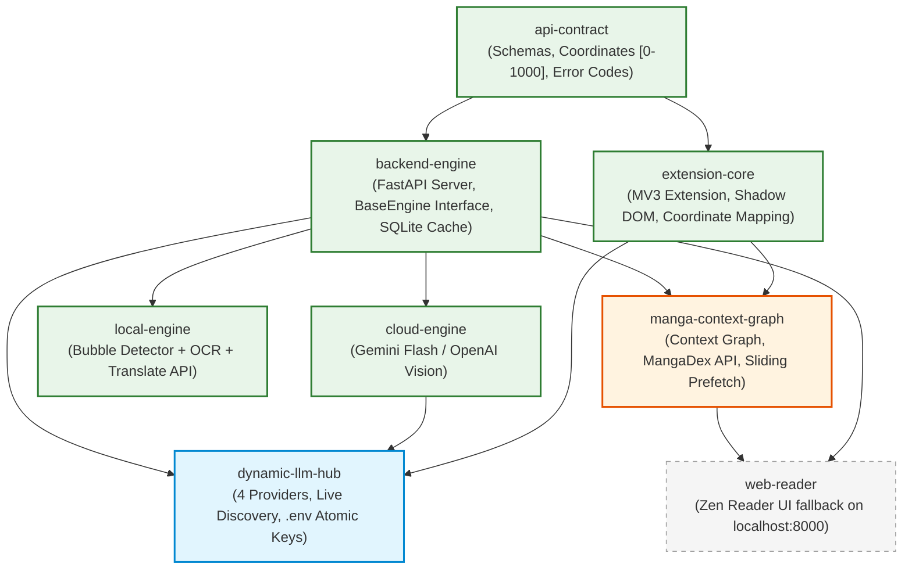

# Capability Map: InkShift — Manga Translation Engine

> **Source:** [fisrt-ideal.md](../temp/fisrt-ideal.md) (Raw initial concept)  
> **Status:** PROPOSED — Awaiting Developer Review & Approval (Verify)  
> **Created:** 2026-10-09  
> **Standard:** Phase 0 (Scope Check & Capability Map) — `spec-driven-development`  
> **Language Policy:** Official English document tracked in Git. Parallel Vietnamese copy at [CAPABILITY_MAP.md](../vi/specs/CAPABILITY_MAP.md) (local, ignored via `.gitignore`).

---

## 1. Decomposition Objective

Deconstruct the raw product vision ([fisrt-ideal.md](../temp/fisrt-ideal.md)) into **6 independent functional modules**. Each module represents a distinct capability with clear boundaries, independently testable contracts, and dedicated technical decisions to be made by the developer before implementation.

---

## 2. Seven Functional Modules

| Module ID | Module Name | Core Responsibility | Depends on |
|---|---|---|---|
| `api-contract` | API Contract & Data Schemas | Canonical interface definition (Pydantic request/response models, normalized `[0–1000]` coordinate system, error codes, status enums) between Chrome Extension ↔ FastAPI Backend. Serves as the immutable boundary contract. | *(None — Root Foundation)* |
| `backend-engine` | Backend Runtime & Engine Coordinator | FastAPI web server, pluggable engine loader interface (`BaseTranslationEngine`), SQLite translation caching layer, dual-engine orchestrator (Cloud & Local), `/api/v1/*` endpoints. | `api-contract` |
| `cloud-engine` | Cloud Vision Turbo Provider | Engine implementation integrating Vision LLMs (Gemini 2.0 Flash / OpenAI Vision). Ingests image $\rightarrow$ outputs bounding boxes + contextual Vietnamese translation in a single round-trip. | `api-contract`, `backend-engine` |
| `local-engine` | Local Offline Pipeline Provider | 100% on-device offline engine: Text Bubble Detector $\rightarrow$ Dual OCR (Single-Pass Full-Page RapidOCR for Non-JA / Crop MangaOCR for Japanese) $\rightarrow$ Translation (Free Google Translate API / Local Model). Forever free, zero external API costs. | `api-contract`, `backend-engine` |
| `extension-core` | Chrome Extension (Manifest V3) | Manga image extraction from DOM, CORS bypass via Service Worker, **Shadow DOM Overlay** renderer (CSS-isolated), coordinate scaling engine, `ResizeObserver` drift mitigation, popup UI, and shortcuts. | `api-contract` |
| `manga-context-graph` | Context Graph & In-Memory Prefetch | Relational reading context (`manga_series`, `manga_chapters`, `chapter_pages`), MangaDex At-Home direct manifest extractor, singleflight request deduplication, and sliding window prefetch scheduler for zero-wait reading. | `api-contract`, `backend-engine`, `extension-core` |
| `dynamic-llm-hub` | Dynamic LLM Provider Hub | 4-Tier Provider Management (Google, OpenAI, Anthropic, Custom), zero-hardcoding live catalog discovery proxy, mode-aware multimodal vision filtering, atomic `.env` single source of truth, and searchable combobox with single-model persistence. | `api-contract`, `backend-engine`, `cloud-engine`, `extension-core` |
| `web-reader` | Local Web Reader (Zen Reader) | Dedicated local reader UI (`localhost:8000/reader`) serving as fallback when websites employ canvas scrambling, WebGL tiles, or anti-inspect guards. Allows custom fonts, sizing, and backend settings. | `api-contract`, `backend-engine`, `manga-context-graph` |

---

## 3. Dependency Graph



---

## 4. Proposed Build Order

```
[Phase 1: Contract Foundation]
api-contract
   │
   ├──→ [Phase 2: Execution Runtimes (Parallel)]
   │    backend-engine ──────────────┐
   │    extension-core (DOM & Mock)  │
   │                                 │
   └──→ [Phase 3: Real Engines & Reading UX]
        ├── cloud-engine (Turbo)
        ├── local-engine (Offline)
        └── web-reader (Zen Fallback)
```

1. **Phase 1 (`api-contract`):** Freeze schemas and normalized coordinate model. Frontend and backend develop concurrently using mock contracts.
2. **Phase 2 (`backend-engine` + `extension-core`):** Scaffold FastAPI runtime (with mock responses) and Extension MV3 scaffold (DOM scanner, basic overlay testing).
3. **Phase 3 (`cloud-engine`, `local-engine`, `web-reader`):** Wire real AI engines and complete the standalone Zen Reader interface.

---

## 5. Architectural & Technical Decisions per Module

Each module requires an independent specification (`SPEC-{module-id}.md`) and architectural decision record (ADR):

| Module ID | Key Decisions Needed | Target ADR |
|---|---|---|
| `api-contract` | - Coordinate format: Integer `0–1000` vs. float `0.0–1.0`?<br>- Image transport: Base64 string in JSON body vs. Binary Multipart Form-Data?<br>- Streaming protocol: Server-Sent Events (SSE) for streaming bubbles vs. batch JSON? | `ADR-002` |
| `backend-engine` | - Python runtime: 3.11 vs. 3.12?<br>- Dependency manager: `uv` vs. `poetry` vs. `pip` + `requirements.txt`?<br>- SQLite persistence: SQLModel, async SQLAlchemy, or raw `sqlite3`?<br>- Engine loader pattern: Dynamic plugin factory vs. Dependency Injection? | `ADR-003` |
| `cloud-engine` | - Primary model: Gemini 2.0 Flash vs. 1.5 Flash vs. OpenAI GPT-4o-mini?<br>- Client library: `google-genai` official SDK vs. raw HTTP client (`httpx`)?<br>- Prompt strategy: Structured Outputs (JSON Schema) vs. markdown extraction?<br>- Retry policy: Exponential backoff on rate limits (429)? | `ADR-004` |
| `local-engine` | - Text Bubble Detector: YOLOv8-manga vs. CRAFT vs. Comic-Text-Detector (ONNX runtime)?<br>- OCR model: `manga-ocr` (PyTorch) vs. PaddleOCR (multilingual)?<br>- Translation engine: `deep-translator` (Google Translate free) vs. local LLM via Ollama?<br>- Hardware target: CPU-only baseline vs. CUDA acceleration? | `ADR-005` |
| `extension-core` | - Build toolchain: Vite + TypeScript vs. Vanilla JavaScript?<br>- Popup UI: Vanilla HTML/CSS vs. Preact/Tailwind?<br>- Coordinate scaling: Aspect ratio letterbox compensation for `object-fit: contain`.<br>- Messaging: `chrome.runtime.sendMessage` between Content Script and Service Worker. | `ADR-006` |
| `web-reader` | - Frontend tech: Server-side rendered (Jinja2 + Vanilla JS) vs. Static SPA (Vite)?<br>- Scramble extraction strategy: Blob forwarding vs. `chrome.tabs.captureVisibleTab`? | `ADR-007` |

---

## 6. Out of Scope for MVP (Strict 4-Week Scope)

- ❌ **AI Inpainting:** No background repainting / text removal. Semi-transparent text boxes ensure 0ms render lag.
- ❌ **Cloud Auth / Accounts / Payments:** Local-only configuration (`chrome.storage.local` and local SQLite).
- ❌ **Non-Chromium Browsers:** Exclusively targeting Chromium (Chrome, Edge, Brave, Coc Coc).
- ❌ **Mobile / Tablet Apps:** Desktop browser focus only.

---

## 7. Next Steps

1. **Developer Verification:** Review and approve the 6 module boundaries, dependency graph, and build order.
2. **Prerequisite Constraints (`constraint-driven-development`):** Establish quality, performance, and testing benchmarks in `CONSTRAINTS.md`.
3. **Module-by-Module Design (`spec-driven-development` + `documentation-and-adrs`):** Begin drafting SPEC and ADR for `api-contract`.
