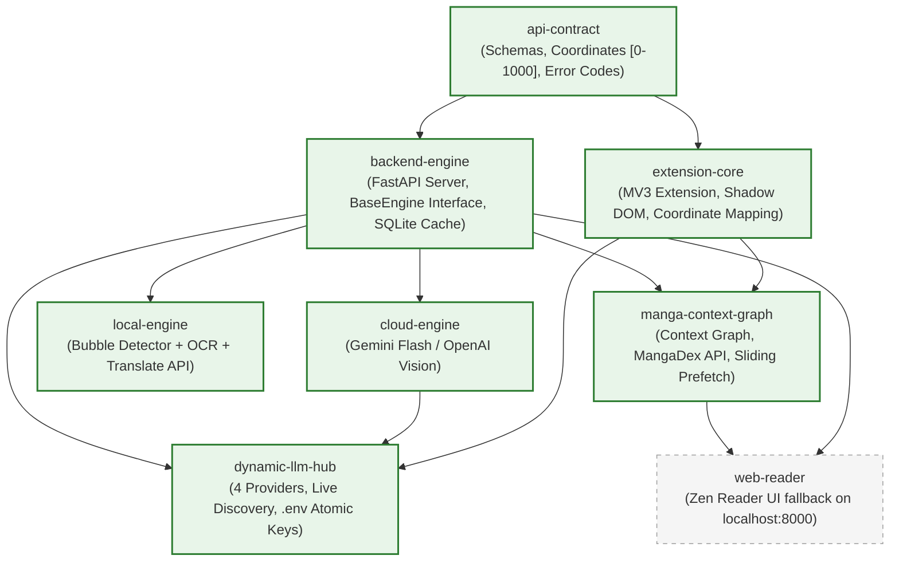

# Capability Map: InkShift — Manga Translation Engine

> **Source:** [fisrt-ideal.md](../temp/fisrt-ideal.md) (Raw initial concept)  
> **Status:** Implemented (Modules 0–7 Completed; `web-reader` Deferred)  
> **Created:** 2026-10-09 | **Last Synced:** 2026-11-19 (Phase 47)  
> **Standard:** Phase 0 (Scope Check & Capability Map) — `spec-driven-development`  
> **Language Policy:** Official English document tracked in Git. Parallel Vietnamese copy at [CAPABILITY_MAP.md](../vi/specs/CAPABILITY_MAP.md) (local, ignored via `.gitignore`).

---

## 1. Decomposition Objective

Deconstruct the raw product vision ([fisrt-ideal.md](../temp/fisrt-ideal.md)) into **8 functional modules (7 implemented + 1 deferred)**. Each module represents a distinct capability with clear boundaries, independently testable contracts, and dedicated technical decisions approved by the developer.

---

## 2. Eight Functional Modules (7 Implemented + 1 Deferred)

| Module ID | Module Name | Core Responsibility | Depends on |
|---|---|---|---|
| `api-contract` | API Contract & Data Schemas | Canonical interface definition (Pydantic request/response models, normalized `[0–1000]` coordinate system, error codes, status enums) between Chrome Extension ↔ FastAPI Backend. Serves as the immutable boundary contract. | *(None — Root Foundation)* |
| `backend-engine` | Backend Runtime & Engine Coordinator | FastAPI web server, pluggable engine loader interface (`BaseTranslationEngine`), 5-column SQLite translation cache with `is_fallback` zero-poisoning, `PriorityLocalLock` scheduler, `/api/v1/*` endpoints. | `api-contract` |
| `cloud-engine` | Cloud Vision Turbo Provider | Engine implementation integrating Vision LLMs (Google Gemini, OpenAI, Anthropic, Custom OpenAI-compatible) via `ProviderRegistry` with Set-of-Marks visual grounding, `safe_mask`, and `custom_prompt`. | `api-contract`, `backend-engine` |
| `local-engine` | Local Offline Pipeline Provider | 100% on-device hybrid layout & OCR pipeline: `YOLO11s-seg` + `PP-OCRv6_medium` DirectML (lazy `korean_PP-OCRv5_rec_mobile` fallback, 2D Union-Find residual clustering, panel/bubble barriers, IoMin SFX exclusion) $\rightarrow$ Translation (`GoogleFreeTranslator` / `LLMTextTranslator`). | `api-contract`, `backend-engine` |
| `extension-core` | Chrome Extension (Manifest V3) | Manga image extraction from DOM, modular `SiteAdapterRegistry` (`MangaDex`, `Hitomi`), CORS/DNR bypass via Service Worker, **Shadow DOM Overlay** renderer (CSS-isolated), coordinate scaling engine, Bento Popup UI, Mascot HUD, and shortcuts. | `api-contract` |
| `manga-context-graph` | Context Graph & In-Memory Prefetch | Relational reading context (`manga_series`, `manga_chapters`, `chapter_pages`), manifest extractors, client/backend singleflight deduplication, `PriorityLocalLock` (`P0` LIFO preemption), `CANCEL_PENDING_TRANSLATIONS`, and sliding window prefetch scheduler. | `api-contract`, `backend-engine`, `extension-core` |
| `dynamic-llm-hub` | Dynamic LLM Provider Hub | 4-Tier Provider Management (Google, OpenAI, Anthropic, Custom), zero-hardcoding live catalog discovery proxy, mode-aware multimodal vision filtering, atomic `.env` single source of truth, and searchable combobox with single-model persistence. | `api-contract`, `backend-engine`, `cloud-engine`, `extension-core` |
| `web-reader` *(Deferred)* | Local Web Reader (Zen Reader) | Dedicated local reader UI (`localhost:8000/reader`) planned as fallback when websites employ canvas scrambling, WebGL tiles, or anti-inspect guards. | `api-contract`, `backend-engine`, `manga-context-graph` |

---

## 3. Dependency Graph



---

## 4. Proposed Build Order

```
[Phase 1: Contract Foundation]
api-contract
   │
   ├──→ [Phase 2: Execution Runtimes (Parallel)]
   │    backend-engine ──────────────┐
   │    extension-core (DOM & Mock)  │
   │                                 │
   └──→ [Phase 3: Real Engines & Reading UX]
        ├── cloud-engine (Turbo)
        ├── local-engine (Offline)
        └── web-reader (Zen Fallback)
```

1. **Phase 1 (`api-contract`):** Freeze schemas and normalized coordinate model. Frontend and backend develop concurrently using mock contracts.
2. **Phase 2 (`backend-engine` + `extension-core`):** Scaffold FastAPI runtime (with mock responses) and Extension MV3 scaffold (DOM scanner, basic overlay testing).
3. **Phase 3 (`cloud-engine`, `local-engine`, `web-reader`):** Wire real AI engines and complete the standalone Zen Reader interface.

---

## 5. Architectural & Technical Decisions per Module

Each module requires an independent specification (`SPEC-{module-id}.md`) and architectural decision record (ADR):

| Module ID | Key Decisions Needed | Target ADR |
|---|---|---|
| `api-contract` | - Coordinate format: Integer `0–1000` vs. float `0.0–1.0`?<br>- Image transport: Base64 string in JSON body vs. Binary Multipart Form-Data?<br>- Streaming protocol: Server-Sent Events (SSE) for streaming bubbles vs. batch JSON? | `ADR-002` |
| `backend-engine` | - Python runtime: 3.11 vs. 3.12?<br>- Dependency manager: `uv` vs. `poetry` vs. `pip` + `requirements.txt`?<br>- SQLite persistence: SQLModel, async SQLAlchemy, or raw `sqlite3`?<br>- Engine loader pattern: Dynamic plugin factory vs. Dependency Injection? | `ADR-003` |
| `cloud-engine` | - Primary model: Gemini 2.0 Flash vs. 1.5 Flash vs. OpenAI GPT-4o-mini?<br>- Client library: `google-genai` official SDK vs. raw HTTP client (`httpx`)?<br>- Prompt strategy: Structured Outputs (JSON Schema) vs. markdown extraction?<br>- Retry policy: Exponential backoff on rate limits (429)? | `ADR-004` |
| `local-engine` | - Text Bubble & Layout Detector: `YOLO11s-seg` ONNX DirectML (Option G1 Gateway)<br>- OCR Model: Single-pass `PP-OCRv6_medium` (`rapidocr>=3.9.1`) + lazy `korean_PP-OCRv5_rec_mobile` + 2D Union-Find residual clustering<br>- Translation Engine: `google-free` (`deep-translator`) or `LLMTextTranslator` with JSON repair<br>- Hardware Target: DirectML GPU primary + `CPUExecutionProvider` fallback | `ADR-006`, `ADR-007`, `ADR-008`, `ADR-017`, `ADR-019`, `ADR-020` |
| `extension-core` | - Build Toolchain: Vite + TypeScript MV3<br>- Popup UI: Bento UI + Mascot HUD (Vanilla HTML/CSS + Constructable Stylesheets)<br>- Site Adapters: `SiteAdapterRegistry` (`MangaDexAdapter`, `HitomiAdapter`)<br>- Coordinate Scaling: Letterbox compensation (`object-fit: contain`) + responsive rescaling | `ADR-005`, `ADR-009`, `ADR-013`, `ADR-014`, `ADR-015`, `ADR-016`, `ADR-020` |
| `manga-context-graph` | - Context DB: SQLite (`manga_series`, `manga_chapters`, `chapter_pages`)<br>- Priority Lock & Cancellation: `PriorityLocalLock` (`P0` LIFO preemption) + `CANCEL_PENDING_TRANSLATIONS` | `ADR-010`, `ADR-020` |
| `dynamic-llm-hub` | - Live Catalog Proxy: 4-tier discovery + atomic `.env` persistence | `ADR-012`, `ADR-020` |
| `web-reader` | - Standalone Zen Reader UI fallback (Deferred post-MVP) | *(Deferred)* |

---

## 6. Out of Scope for MVP (Strict 4-Week Scope)

- ❌ **AI Inpainting:** No background repainting / text removal. Semi-transparent text boxes ensure 0ms render lag.
- ❌ **Cloud Auth / Accounts / Payments:** Local-only configuration (`chrome.storage.local` and local SQLite).
- ❌ **Non-Chromium Browsers:** Exclusively targeting Chromium (Chrome, Edge, Brave, Coc Coc).
- ❌ **Mobile / Tablet Apps:** Desktop browser focus only.

---

## 7. Next Steps

1. **Developer Verification:** Review and approve the 6 module boundaries, dependency graph, and build order.
2. **Prerequisite Constraints (`constraint-driven-development`):** Establish quality, performance, and testing benchmarks in `CONSTRAINTS.md`.
3. **Module-by-Module Design (`spec-driven-development` + `documentation-and-adrs`):** Begin drafting SPEC and ADR for `api-contract`.
