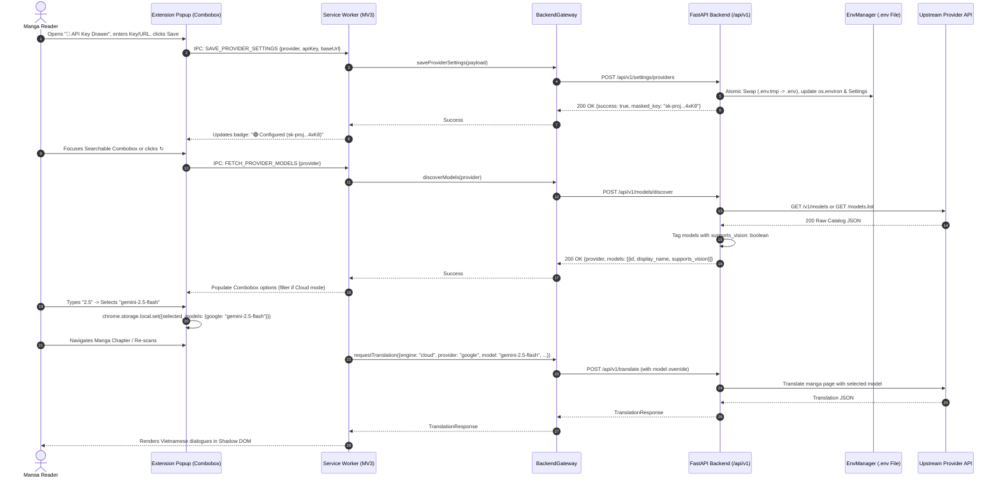

# Spec: Dynamic LLM Provider Hub (`dynamic-llm-hub`)

> **Module ID:** `dynamic-llm-hub`  
> **Source ADR:** [ADR-012-dynamic-llm-provider-hub.md](../decisions/ADR-012-dynamic-llm-provider-hub.md)  
> **Parent Map:** [CAPABILITY_MAP.md](CAPABILITY_MAP.md)  
> **Contract Spec:** [SPEC-api-contract.md](SPEC-api-contract.md)  
> **Backend Spec:** [SPEC-backend-engine.md](SPEC-backend-engine.md), [SPEC-cloud-engine.md](SPEC-cloud-engine.md), [SPEC-local-engine.md](SPEC-local-engine.md)  
> **Extension Spec:** [SPEC-extension-core.md](SPEC-extension-core.md)  
> **Status:** APPROVED (Spec-Driven Development Phase 1)  
> **Phase:** Phase 25 — Dynamic Multi-Provider Live Discovery & In-Extension Management  
> **Quality Gate:** [CONSTRAINTS.md](../../CONSTRAINTS.md) (Zero suppressions, strict types, coverage $\ge 80\%$)  
> **Language Policy:** Official English document tracked in Git. Parallel Vietnamese copy at [docs/vi/specs/SPEC-dynamic-llm-hub.md](../vi/specs/SPEC-dynamic-llm-hub.md).  

---

## 1. Assumptions Surface

Before proceeding to implementation, the following architectural assumptions are recorded and verified:
1. **Single Source of Truth for Keys:** API keys (`GEMINI_API_KEY`, `OPENAI_API_KEY`, `ANTHROPIC_API_KEY`, `CUSTOM_API_KEY`) and custom endpoint URLs (`CUSTOM_BASE_URL`) reside **exclusively in the local `.env` file** on the user's host machine. The Chrome Extension never retains raw API keys in persistent extension storage.
2. **Zero-Hardcoding Live Catalog:** Neither the FastAPI backend nor the Chromium extension shall maintain static arrays or hardcoded lists of model identifiers. Every available model must be fetched live from the provider's upstream catalog endpoint (`/v1/models`, Google `models.list`).
3. **Backend Discovery Proxy:** The Chromium extension shall not query upstream provider catalog APIs directly (preventing CORS failures and header leaks). All catalog queries route through the local FastAPI server (`POST /api/v1/models/discover`).
4. **Smart Multimodal/Vision Filtering:** In **Cloud AI mode**, manga translation requires visual input; only models verified as supporting multimodal/vision are rendered in the UI. In **Local DirectML mode**, text translators accept all text-generation chat models.
5. **Single-Model Persistence:** The extension preserves only the user's active selected model identifier (`selected_model`) per provider in `chrome.storage.local`. On subsequent browser launches, this selected model loads immediately with zero startup network latency.
6. **Backward Compatibility:** All existing provider aliases (`xkiro` -> `custom`, `cloud-gemini` -> `google`, `llm-qwen` -> `custom`, `llm-gemini` -> `google`) remain functional without breaking existing test suites or cached requests.
7. **Zero New External Packages:** All provider integrations and catalog parsers utilize the already installed asynchronous HTTP stack (`httpx >= 0.27.0`) and standard library utilities (`os`, `json`, `re`).

---

## 2. Objective & Background

### 2.1 The Problem
InkShift previously supported hardcoded cloud vision models (`gemini-3.8-flash`, `qwen/qwen3.8-max:free`) and static HTML select options. This had three fatal flaws:
1. **Model Staleness:** When providers release superior or cheaper models (e.g., `gemini-2.5-flash`, `gpt-4o-mini`, `claude-3-5-sonnet`), the application required code modification to access them.
2. **Missing Major Providers:** Anthropic Claude (industry leader for creative nuance) and official OpenAI were not first-class options alongside Google and Custom endpoints.
3. **Configuration Friction:** Users had to manually edit the `.env` file and restart the backend server whenever changing keys or switching between local Ollama and cloud providers.

### 2.2 The Solution
Deliver a unified **Dynamic LLM Provider Hub** across 4 canonical provider tiers:
1. **Google Gemini:** Official AI Studio API (`v1beta/models`).
2. **OpenAI:** Official OpenAI API (`api.openai.com/v1/models`).
3. **Anthropic Claude:** Official Anthropic API (`api.anthropic.com/v1/models`).
4. **Custom (OpenAI-Compatible):** Configurable base URL (supporting DeepSeek, Groq, OpenRouter, local Ollama, LM Studio).

Featuring:
- Zero-hardcoding live catalog discovery proxy.
- In-extension API key & Base URL drawer with atomic `.env` persistence.
- Searchable Combobox with instant substring matching (e.g., typing `"2"` surfaces `gemini-2.0-flash` and `gemini-2.5-flash`).
- Mode-aware vision capability filtering.
- Comprehensive defensive UX error handling.

---

## 3. Architecture & Data Flow



---

## 4. Canonical API Contracts & Schemas

### 4.1 Backend Pydantic Schemas (`src/backend/schemas/contract.py`)

#### Update `TranslationRequest`:
```python
class TranslationRequest(BaseModel):
    model_config = ConfigDict(extra="forbid")

    image: str = Field(max_length=20_000_000)
    image_hash: HashString | None = Field(default=None)
    source_lang: str = Field(default="auto")
    target_lang: str = Field(default="vi")
    engine: Literal["local", "cloud", "mock", "auto"] = Field(default="auto")
    provider: str | None = Field(
        default=None,
        description="Optional cloud LLM provider override ('google', 'openai', 'anthropic', 'custom', None=default)",
    )
    translator: str | None = Field(
        default=None,
        description="Optional local text translator override ('google-free', 'llm-google', 'llm-openai', 'llm-anthropic', 'llm-custom', None=default)",
    )
    model: str | None = Field(
        default=None,
        description="Optional dynamic LLM model name override (e.g. 'gemini-2.5-flash', 'gpt-4o', 'claude-3-5-sonnet')",
    )
    force_refresh: bool = Field(default=False)
    chapter_url: str | None = Field(default=None)

    @field_validator("provider", mode="before")
    @classmethod
    def normalize_provider(cls, v: Any) -> str | None:
        if not v:
            return None
        norm = str(v).strip().lower()
        alias_map = {
            "gemini": "google",
            "cloud-gemini": "google",
            "xkiro": "custom",
            "cloud-xkiro": "custom",
        }
        return alias_map.get(norm, norm)
```

#### New Schemas in `src/backend/schemas/models.py`:
```python
class ModelItem(BaseModel):
    id: str = Field(description="Unique model identifier (e.g. 'gemini-2.5-flash', 'gpt-4o')")
    display_name: str = Field(description="Human-friendly label")
    supports_vision: bool = Field(description="Whether the model accepts image inputs")

class ModelDiscoveryRequest(BaseModel):
    provider: Literal["google", "openai", "anthropic", "custom"] = Field(description="Target provider tier")
    api_key_override: str | None = Field(default=None, description="Temporary unsaved API key for probing")
    base_url_override: str | None = Field(default=None, description="Custom base URL override")

class ModelDiscoveryResponse(BaseModel):
    success: Literal[True] = True
    provider: str
    models: list[ModelItem]

class ProviderStatus(BaseModel):
    configured: bool = Field(description="Whether a valid key exists")
    masked_key: str | None = Field(default=None, description="Masked key representation, e.g. AIzaSy...4xK8")
    base_url: str | None = Field(default=None, description="Configured base URL (for custom provider)")

class ProviderSettingsResponse(BaseModel):
    success: Literal[True] = True
    providers: dict[str, ProviderStatus]

class UpdateProviderSettingsRequest(BaseModel):
    provider: Literal["google", "openai", "anthropic", "custom"]
    api_key: str | None = Field(default=None, description="New API key to persist")
    base_url: str | None = Field(default=None, description="New base URL to persist")
```

### 4.2 TypeScript Interfaces (`src/types/contract.ts`)

```typescript
export interface TranslationRequest {
  image: string;
  image_hash?: string;
  source_lang?: string;
  target_lang?: string;
  engine?: EngineMode;
  provider?: 'google' | 'openai' | 'anthropic' | 'custom' | string;
  translator?: string;
  model?: string; // Dynamic model selected via combobox
  force_refresh?: boolean;
  chapter_url?: string;
}

export interface ModelItem {
  id: string;
  display_name: string;
  supports_vision: boolean;
}

export interface ModelDiscoveryResponse {
  success: true;
  provider: string;
  models: ModelItem[];
}

export interface ProviderStatus {
  configured: boolean;
  masked_key: string | null;
  base_url?: string | null;
}

export interface ProviderSettingsResponse {
  success: true;
  providers: Record<'google' | 'openai' | 'anthropic' | 'custom', ProviderStatus>;
}
```

---

## 5. Endpoints Specification

### 5.1 `POST /api/v1/models/discover`
- **Method:** `POST`
- **Rate Limit:** 30 requests/minute per client.
- **Description:** Queries upstream provider catalog endpoint live, parses returned JSON into a standardized list of `ModelItem`, tags multimodal capabilities, and sorts descending by generation/recency.
- **Response Headers:** `Cache-Control: private, max-age=300` (5-minute server-side cache per provider+key hash).
- **Error Responses:**
  - `401 Unauthorized` (`MISSING_CREDENTIALS` / `INVALID_CREDENTIALS`): If provider key is absent or upstream rejects auth.
  - `502 Bad Gateway` (`UPSTREAM_CATALOG_ERROR`): Upstream API unreachable or returned non-JSON.
  - `504 Gateway Timeout` (`UPSTREAM_TIMEOUT`): Upstream query exceeded 10.0 seconds.

### 5.2 `GET /api/v1/settings/providers`
- **Method:** `GET`
- **Description:** Returns the configuration status and masked API keys for all 4 providers.
- **Security:** Never returns raw unmasked keys. Keys are truncated to first 6 and last 4 characters (`AIzaSy...4xK8`).

### 5.3 `POST /api/v1/settings/providers`
- **Method:** `POST`
- **Body:** `UpdateProviderSettingsRequest`
- **Description:** Persists the supplied API key or Base URL into the host machine's `.env` file using atomic temporary file renaming (`.env.tmp` -> `.env`). Immediately updates active `os.environ` and `app.state.settings` in memory.
- **Auditing:** Writes an audit log entry in Logfmt format: `action=UpdateProviderKey provider=openai status=saved`.

---

## 6. Provider Catalog Adapters & Vision Classification

| Provider | Catalog Endpoint | Auth Header | Vision Classification Rule |
|---|---|---|---|
| **Google Gemini** | `GET https://generativelanguage.googleapis.com/v1beta/models?key={KEY}` | Query param `key` or `x-goog-api-key` | `supports_vision = ("generateContent" in supportedGenerationMethods) and not id.startswith("models/text-embedding") and not id.startswith("models/aqa")` |
| **OpenAI** | `GET https://api.openai.com/v1/models` | `Authorization: Bearer {KEY}` | Filter out non-chat models (`embedding`, `tts`, `whisper`, `dall-e`, `moderation`, `babbage`, `davinci`).<br>`supports_vision = any(k in id for k in ["gpt-4o", "gpt-4-turbo", "gpt-4-vision", "o1", "gpt-4.5"])` |
| **Anthropic Claude** | `GET https://api.anthropic.com/v1/models` | `x-api-key: {KEY}`, `anthropic-version: 2023-06-01` | All Claude 3 and 3.5 family models (`claude-3-*`, `claude-3-5-*`) support vision natively: `supports_vision = id.startswith("claude-3")` |
| **Custom (OpenAI-compat)** | `GET {base_url}/models` | `Authorization: Bearer {KEY}` (if provided) | Keyword heuristic matching: `supports_vision = any(k in id.lower() for k in ["vl", "vision", "multimodal", "4o", "gemini", "claude", "pixtral", "internvl", "minicpm", "qwen2.5-vl", "llava"])` |

---

## 7. Security & Key Governance

1. **Storage Isolation:** Raw keys are written strictly to `.env`. The extension never stores raw keys in `chrome.storage.local` or `localStorage`.
2. **Atomic File Write:**
   ```python
   def atomic_write_env(filepath: str, updates: dict[str, str]) -> None:
       temp_path = f"{filepath}.tmp"
       lines = read_existing_lines(filepath)
       merged_lines = merge_env_lines(lines, updates)
       with open(temp_path, "w", encoding="utf-8") as f:
           f.writelines(merged_lines)
       os.replace(temp_path, filepath)  # Atomic rename on Windows/Linux
   ```
3. **Sensitive Data Masking:**
   ```python
   def mask_api_key(key: str) -> str:
       if not key or len(key) <= 10:
           return "********"
       return f"{key[:6]}...{key[-4:]}"
   ```
4. **Git Protection:** `.env` remains ignored in `.gitignore`. Pre-commit hooks run `gitleaks protect --staged` to prevent accidental credential commits.

---

## 8. Extension UI: Searchable Combobox & Single-Model Persistence

### 8.1 Combobox UX Requirements
- **Structure:** Text `<input id="model-search-input">` paired with a floating dropdown `<div id="model-dropdown-list">`.
- **Search Behavior:** Case-insensitive substring matching. Typing `"2"` filters and highlights `gemini-2.0-flash`, `gemini-2.5-flash`.
- **Keyboard Navigation:**
  - `ArrowDown` / `ArrowUp`: Highlights items in dropdown list.
  - `Enter`: Selects highlighted item and closes dropdown.
  - `Escape`: Closes dropdown without changing selection.
- **Mode Switching Filter:**
  - When switching engine to `Cloud AI`, combobox hides models with `supports_vision === false`. If currently selected model lacks vision, automatically fall back to the first available vision model with a toast warning.
  - When switching engine to `Local DirectML`, all text generation models are enabled.

### 8.2 Single-Model Persistence
- **Storage Shape in `chrome.storage.local`:**
  ```json
  {
    "selected_models": {
      "google": "gemini-2.5-flash",
      "openai": "gpt-4o-mini",
      "anthropic": "claude-3-5-sonnet-20241022",
      "custom": "deepseek-chat"
    }
  }
  ```
- **Lifecycle:**
  - Popup opening: reads `selected_models[activeProvider]`, immediately writes text into `#model-search-input`. **No network request is triggered.**
  - Live discovery only executes if:
    1. User clicks the input to open the dropdown list and cache is empty/expired.
    2. User clicks the "Refresh Models" button (`↻`).
    3. User switches provider tier.

---

## 9. Defensive UX Error Handling Matrix

| # | Edge-Case Scenario | Trigger Condition | System Behavior & User Feedback |
|---|---|---|---|
| **E1** | **Missing API Key** | User selects provider with `configured == false` and triggers translate or discovery | Combobox disabled; red badge: *"Chưa nhập API Key"*; auto-expands API Key Drawer with focus on input. |
| **E2** | **No Model Selected** | User cleared input or upstream returned empty catalog | "Re-scan" and page translation buttons disabled; helper text: *"Vui lòng chọn model"*. |
| **E3** | **Malformed Base URL** | Custom Base URL missing `http://` or invalid domain | Inline input validation warning: *"Base URL phải bắt đầu bằng http:// hoặc https://"*. |
| **E4** | **Invalid Key / 401** | Upstream provider returns 401 Unauthorized | Toast error: *"API Key không hợp lệ hoặc đã hết hạn"*; key drawer status turns red. |
| **E5** | **Rate Limit / 429** | Upstream returns 429 Quota Exceeded | 2 automatic exponential backoff retries (0.5s, 1.5s); if still 429, displays *"Hết quota API - vui lòng thử lại sau hoặc đổi model"*. |
| **E6** | **Non-Vision in Cloud** | User attempts to force text model in Cloud mode | Blocked at Combobox; toast warning: *"Model này không hỗ trợ đọc ảnh. Đã chuyển sang model Vision mặc định"*. |
| **E7** | **Offline Backend** | Backend server is not running on `localhost:8000` | Header badge shows `Offline`; API Key Drawer and Combobox show clear banner: *"Khởi động backend: python -m src.backend.app"*. |
| **E8** | **In-Flight Race** | User changes model while translation is processing | Ongoing page translation completes with initiated model; subsequent pages adopt the newly selected model cleanly. |

---

## 10. Commands & Quality Gates

### 10.1 Verification Commands
```bash
# 1. Backend Lint & Typecheck
python -m ruff check src/backend tests/backend
python -m mypy src/backend tests/backend

# 2. Backend Unit & Integration Tests
pytest tests/backend/test_models_api.py tests/backend/test_env_manager.py tests/backend/engines/cloud/test_anthropic.py -v

# 3. Extension Lint & Typecheck
npm run type-check

# 4. Extension Unit Tests
npm test -- tests/extension/test_popup.test.ts

# 5. Full Project Fast Gate (Floor Guard 0 Suppressions)
python scripts/check.py --fast
```

### 10.2 Strict Floor Guard Constraints
- **0 Suppressions:** No `# type: ignore`, `# noqa`, `@ts-ignore`, or `eslint-disable`.
- **Coverage:** $\ge 80\%$ on all new backend routers and providers.
- **Strict Typing:** All FastAPI endpoints declare explicit request/response schemas; all TypeScript interfaces strictly typed.

---

## 11. Traceability & Review Sign-off

- **Spec Author:** AI Assistant (Agentic Pair Programmer)
- **Reviewer & Decision Authority:** Solo Developer (human)
- **Associated ADR:** [docs/decisions/ADR-012-dynamic-llm-provider-hub.md](../decisions/ADR-012-dynamic-llm-provider-hub.md)
- **Status:** **Ready for Human Sign-off**
