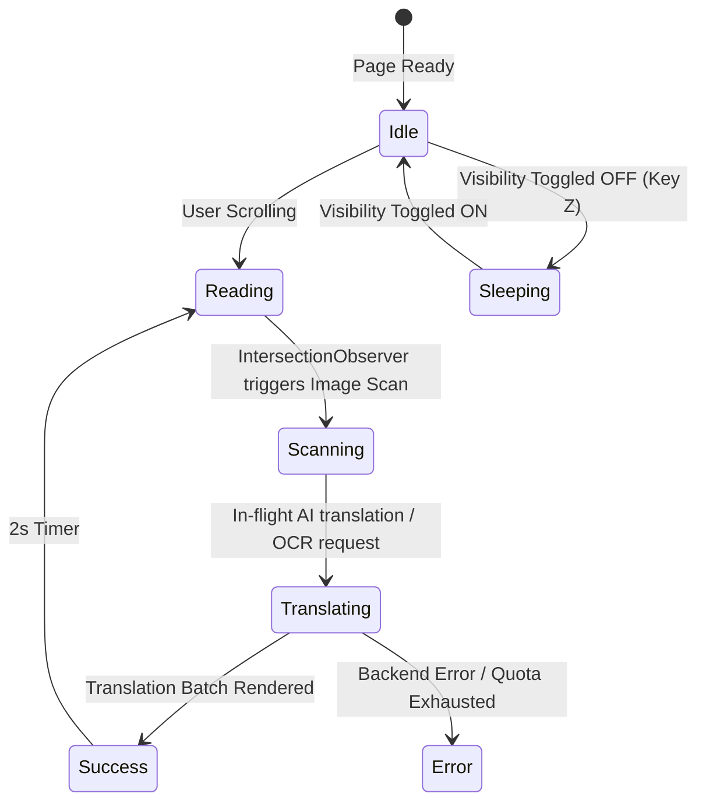

# Spec: Unified UI Overhaul — Bento Popup UI & Dynamic Floating Mascot HUD

> **Module ID:** `extension-ui-overhaul`  
> **Milestone:** Phase 29  
> **Source Design System:** [design-system/inkshift/MASTER.md](../../design-system/inkshift/MASTER.md)  
> **Design Overrides:** [popup.md](../../design-system/inkshift/pages/popup.md), [mascot-hud.md](../../design-system/inkshift/pages/mascot-hud.md)  
> **Governing Rules:** `spec-driven-development`, `ui-ux-pro-max`, `design-system`, `planning-and-task-breakdown`, `test-driven-development`  
> **Status:** PROPOSED — Awaiting Developer Review & Approval (@human)

---

## 1. Objective

Deliver a comprehensive UI/UX overhaul of InkShift:
1. Re-architect the monolithic Extension Popup (`popup.html`, `popup.ts`, `popup.css`) into a clean **2-View Bento Grid** model (compact Main Reading View $\le 420\text{px}$ without vertical scroll fatigue + Settings Drawer via gear icon ⚙️).
2. Integrate an in-page **Dynamic Floating Mascot HUD** inside the isolated Shadow DOM, featuring draggable edge-docking physics and live animation state changes that visually communicate the active translation lifecycle.
3. Support **In-Place Popup Expansion** from the mascot, allowing seamless reader control without opening the browser toolbar popup.
4. Establish the unified **Warm Obsidian & Mascot Terracotta (`#DE886D`)** design system across all UI surfaces with strict WCAG AAA contrast compliance.

---

## 2. Problem Statement & Current UX Deficiencies

1. **Monolithic Form Fatigue:**  
   `popup.html` currently stacks 18 form elements, sliders, and drawers vertically into a ~1200px scrollable column. Users must scroll through API keys, blacklist inputs, and debug toggles just to change a manga font or adjust opacity.
2. **Disconnected Context & Toolbar Friction:**  
   When immersed in full-screen manga reading on MangaDex, users must mouse up to the top-right Chrome toolbar to click the extension icon. Clicking anywhere outside immediately dismisses the popup.
3. **Opaque Background Pipeline:**  
   The user has no immediate visual awareness of whether YOLO bubble detection is scanning, an AI request is in-flight, or sliding-window prefetch is active, except by inspecting devtools logs.
4. **Visual Discordance:**  
   Current popup styles use arbitrary dark grays (`#18181b`, `#27272a`) and blue accents that clash with the manga reading aesthetic and lack character identity.

---

## 3. Architecture & Functional Specification

### 3.1 Design System & Token Foundation (`tokens.css`)

Create a shared token stylesheet `src/extension/shared/tokens.css` exposing CSS custom properties declared in `design-system/inkshift/MASTER.md`:
- **Backgrounds:** `--inkshift-bg: #12100E`, `--inkshift-card: #1C1917`, `--inkshift-card-hover: #231F1C`.
- **Text:** `--inkshift-text-primary: #FAF5F0` (contrast 16.2:1), `--inkshift-text-secondary: #A8A29E`.
- **Brand Signature:** `--inkshift-brand: #DE886D` (Mascot body color), `--inkshift-brand-hover: #E89D84`.
- **Borders & Rings:** `--inkshift-border-subtle: #2E2825`, `--inkshift-border-brand: rgba(222, 136, 109, 0.35)`.
- **Feedback:** `--inkshift-success: #10B981`, `--inkshift-warning: #F59E0B`, `--inkshift-danger: #E11D48`.

---

### 3.2 Two-View Extension Popup Architecture

The popup window is bounded to `width: 400px; max-height: 560px;`:

```
┌────────────────────────────────────────────────────────┐
│  [Logo] InkShift                   [ONLINE]    [ GEAR ] │ ← Header
├────────────────────────────────────────────────────────┤
│                      VIEW A (MAIN)                     │
│ ┌─ Active Domain Card ───────────────────────────────┐ │
│ │  MangaDex.org                      [Supported]     │ │
│ │  Press "Alt+Z" to toggle translation overlays      │ │
│ └────────────────────────────────────────────────────┘ │
│                                                        │
│  [ TRANSLATION ACTIVE ]               [ ● Switch ON ]  │ ← Master Toggle
│  [ Rescan & Translate Active Page ]                    │ ← Primary CTA
│                                                        │
│ ┌─ Engine & Model Quick Picker ──────────────────────┐ │
│ │  [ Cloud AI (Default) ▼ ]   [ Model: Gemini 2.0 ▼] │ │
│ └────────────────────────────────────────────────────┘ │
│                                                        │
│ ┌─ Manga Reading Aesthetics ─────────────────────────┐ │
│ │  • Typography:  [ Manga Comic (Itim)           ▼ ] │ │
│ │  • Background:  [ Cream Ivory ] [ OLED Black ]     │ │
│ │  • Opacity:     [══════════●════] 88%              │ │
│ │  • Target Lang: [ Vietnamese                   ▼ ] │ │
│ └────────────────────────────────────────────────────┘ │
└────────────────────────────────────────────────────────┘
```

- **Smooth View Transition:** Clicking the gear icon button adds `.view-settings-active` to `#app`, smoothly sliding View A out to the left and View B (Settings) in from the right (`transform: translateX(...) 200ms cubic-bezier(0.16, 1, 0.3, 1)`).
- **Settings View Structure:** Organized into clean collapsible accordions:
  - **API Keys & Endpoints** (Gemini, OpenAI, Claude, Custom Endpoint).
  - **Domain Rules** (Whitelist tags, Blacklist tags, Add domain form, Reset defaults).
  - **Prefetch & Cache** (Prefetch toggle, depth selector, Cache flush).
  - **Diagnostics** (Visual YOLO debug toggle, Mascot HUD toggle).

---

### 3.3 In-Page Dynamic Floating Mascot HUD (`MascotHUD`)

A lightweight custom component mounted directly inside the content script's **Shadow DOM**:
- **Collapsed Floating Badge:**
  - Character sprite rendered via native vector SVG (`15×16` grid scaled to `36×38px`).
  - Container circular badge `44×44px` with subtle border `rgba(222, 136, 109, 0.25)` and backdrop blur.
  - Initial position: `bottom: 24px; right: 20px;`.
- **Draggable & Edge-Snapping Physics:**
  - Pointer capture on `pointerdown`. Tracks delta movements without lag.
  - On `pointerup`, if released `x < window.innerWidth / 2`, it snaps to `left: 12px`; otherwise to `right: 12px`.
  - Persists vertical coordinate and side in `chrome.storage.local` key `mascotPosition`.
  - Threshold: Pointer moves $< 4\text{px}$ count as a **Click** rather than a drag.
- **In-Place Expanded Bento Card:**
  - On click, mounts a floating card (`width: 360px; max-height: 420px;`) directly adjacent to the mascot.
  - Renders the exact same reading controls as Popup View A.
  - Closes when clicking outside or pressing `Escape`.

---

### 3.4 Live Mascot State Machine Matrix

The mascot reflects content script lifecycle events via reactive state transitions:



| State | Visual Frame | Trigger Source |
|---|---|---|
| `idle` | `clawd-idle.svg` | Page loaded, 0 pending translation requests |
| `reading` | `clawd-idle-reading.svg` | Active viewport reading, book booklet in hand |
| `scanning` | `clawd-working-debugger.svg` | YOLO bubble detection underway on on-screen image |
| `translating` | `clawd-working-typing.svg` | In-flight HTTP request to backend `/api/v1/translate` |
| `success` | `clawd-happy.svg` | Overlay polygons mounted, 1-shot double-jump celebration |
| `error` | `clawd-error.svg` | Network failure, backend offline, or 429 quota error |
| `sleeping` | `clawd-sleeping.svg` | `overlayVisible === false` or domain blacklisted |

---

## 4. Data Exchange & Storage Schema

All controls synchronize reactively via `chrome.storage.local`:

```typescript
export interface InkShiftStorageSchema {
  // Reading Preferences
  overlayVisible: boolean;          // Default: true
  opacity: number;                  // Default: 88
  speechBubbleBg: string;           // Default: '#FAF5F0'
  speechBubbleFont: string;         // Default: 'itim'
  sourceLang: string;               // Default: 'auto'
  
  // Engine & Provider
  engine: 'auto' | 'local' | 'cloud'; // Default: 'auto'
  provider: 'google' | 'openai' | 'anthropic' | 'custom';
  selectedModel: string;
  
  // Prefetch & Layout
  prefetchEnabled: boolean;         // Default: true
  prefetchDepth: number | 'all';    // Default: 3
  
  // Mascot HUD
  mascotEnabled: boolean;           // Default: true
  mascotPosition: { side: 'left' | 'right'; y: number }; // Default: { side: 'right', y: 120 }
  
  // Domain Policies & Keys
  domainWhitelist: string[];
  domainBlacklist: string[];
  debugGeometry: boolean;           // Default: false
}
```

---

## 5. Verification & Quality Gate Plan

1. **Unit & Component Tests (`vitest`):**
   - Author tests in `tests/extension/test_popup_views.test.ts` verifying View A $\leftrightarrow$ View B sliding transitions and key listeners.
   - Author tests in `tests/extension/test_mascot_hud.test.ts` verifying mascot state transitions (`idle` $\to$ `scanning` $\to$ `translating` $\to$ `success`), edge-snapping coordinate clamps, and popover toggle logic.
2. **Accessibility & Floor Guard Compliance:**
   - Verify WCAG AA/AAA contrast ratios for all text on `#12100E` and `#1C1917`.
   - Verify zero suppression comments (`@ts-ignore`, `eslint-disable`, `# noqa`) via `python scripts/check.py --fast`.
   - Verify clean TypeScript build (`npm run typecheck:extension`).
